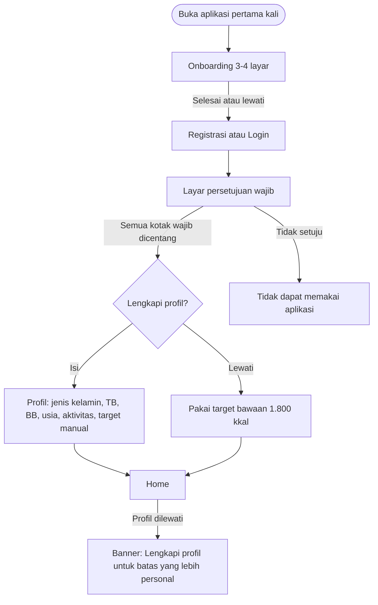
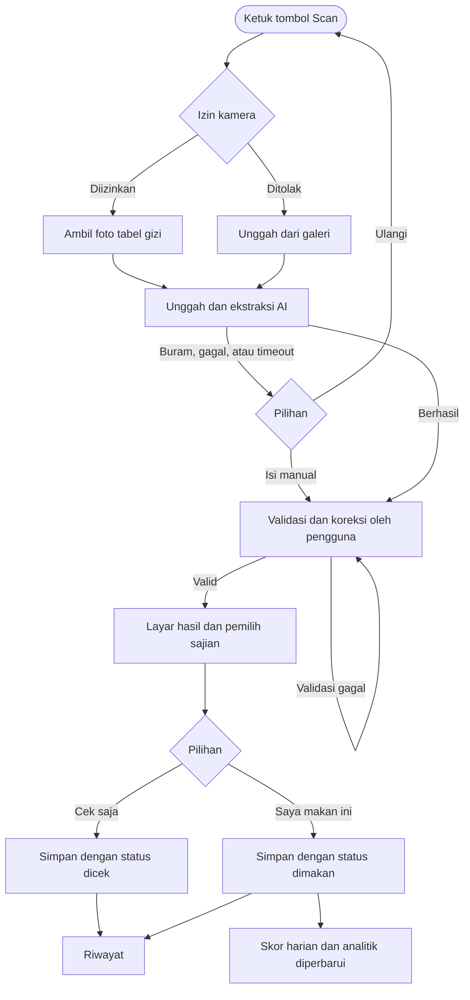
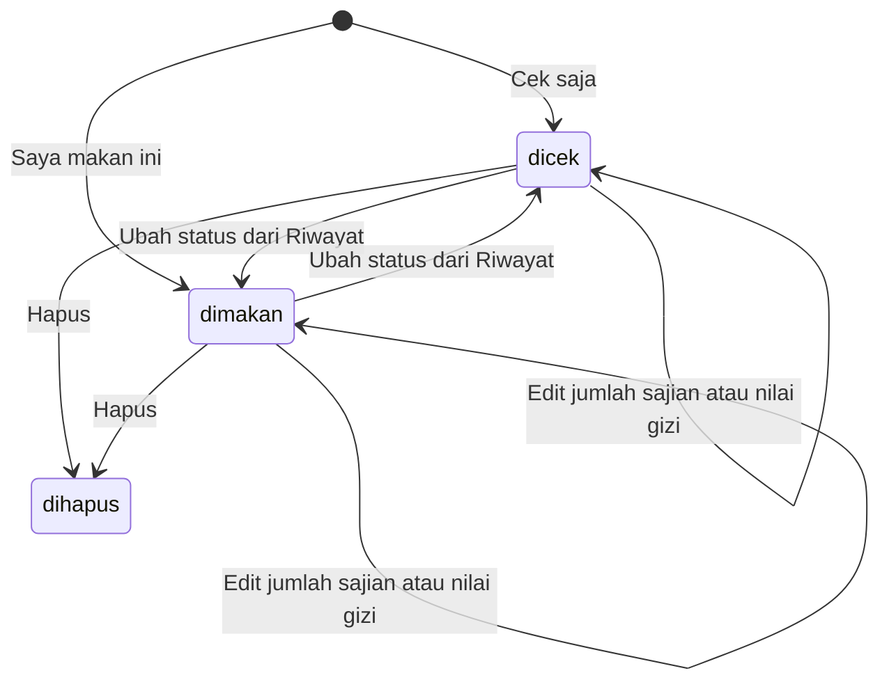

# PRD — Nutri-lab: Pemeriksa Kecocokan Gizi Produk Kemasan untuk Penyandang Diabetes Melitus Tipe 2

| Item                     | Isi                                                                                                         |
| ------------------------ | ----------------------------------------------------------------------------------------------------------- |
| Versi dokumen            | 1.0 (draf untuk review)                                                                                     |
| Versi algoritma          | 0.3 (menggantikan draf 0.2)                                                                                 |
| Tanggal                  | 6 November 2026                                                                                             |
| Pemilik produk           | [isi]                                                                                                       |
| Reviewer yang dibutuhkan | Ahli gizi / klinisi (konten algoritma), penasihat hukum (persetujuan dan data pribadi), perwakilan pengguna |
| Status                   | Draf. Parameter berstatus [A] belum dikalibrasi dan belum divalidasi klinis                                 |

## Daftar isi

1. [Ringkasan eksekutif](#1-ringkasan-eksekutif)
2. [Latar belakang dan masalah](#2-latar-belakang-dan-masalah)
3. [Tujuan, non-tujuan, dan metrik keberhasilan](#3-tujuan-non-tujuan-dan-metrik-keberhasilan)
4. [Pengguna dan persona](#4-pengguna-dan-persona)
5. [Ruang lingkup, asumsi, dan prinsip produk](#5-ruang-lingkup-asumsi-dan-prinsip-produk)
6. [Peta fitur](#6-peta-fitur)
7. [Struktur navigasi](#7-struktur-navigasi)
8. [Alur pengguna](#8-alur-pengguna)
9. [Spesifikasi fungsional per modul](#9-spesifikasi-fungsional-per-modul)
10. [Spesifikasi algoritma penilaian (v0.3)](#10-spesifikasi-algoritma-penilaian-v03)
11. [Model data](#11-model-data)
12. [Arsitektur dan skema ekstraksi](#12-arsitektur-dan-skema-ekstraksi)
13. [Kebutuhan non-fungsional](#13-kebutuhan-non-fungsional)
14. [Privasi, keamanan, dan kepatuhan](#14-privasi-keamanan-dan-kepatuhan)
15. [Analitik produk dan event tracking](#15-analitik-produk-dan-event-tracking)
16. [Rencana validasi dan kalibrasi](#16-rencana-validasi-dan-kalibrasi)
17. [Risiko dan mitigasi](#17-risiko-dan-mitigasi)
18. [Roadmap dan rencana rilis](#18-roadmap-dan-rencana-rilis)
19. [Pertanyaan terbuka](#19-pertanyaan-terbuka)
20. [Lampiran](#20-lampiran)

---

## 1. Ringkasan eksekutif

**Apa ini.** Aplikasi seluler yang membantu penyandang diabetes melitus (DM) tipe 2 dewasa menilai apakah suatu makanan atau minuman kemasan cocok dikonsumsi, berdasarkan **angka pada label gizi kemasan**, **batas harian personal**, dan **apa yang sudah dimakan hari itu**.

**Cara kerja singkat.**

1. Pengguna memotret tabel Informasi Nilai Gizi (ING) pada kemasan.
2. AI membaca label dan mengekstraksi angka-angkanya.
3. Pengguna memvalidasi atau mengoreksi hasil ekstraksi.
4. Mesin penilaian berbasis aturan (rule-based, dapat dijelaskan) menghitung kualitas produk, beban karbohidrat, dan batas gula per porsi dan kumulatif harian.
5. Pengguna memilih jumlah sajian lalu **Cek saja** atau **Saya makan ini**. Entri tersimpan di riwayat, dan hanya yang berstatus "dimakan" menambah skor harian dan analitik.

**Pembeda utama.**

- Penilaian **per porsi yang benar-benar dimakan**, bukan hanya per 100 g.
- **Anggaran harian personal** (karbohidrat, gula) yang berakumulasi sepanjang hari.
- Mesin **transparan**: setiap status disertai pemicunya, dan semua parameter berversi serta dapat dikalibrasi.
- Selaras dengan regulasi Indonesia (PerBPOM No. 10 Tahun 2026 tentang Informasi Nilai Gizi pada Label Pangan Olahan).

**Yang bukan.** Bukan alat medis, bukan alat diagnosis, tidak memprediksi gula darah, dan tidak memberi saran dosis obat atau insulin.

---

## 2. Latar belakang dan masalah

### 2.1 Masalah pengguna

| #   | Masalah                                                                                    | Dampak                                                       |
| --- | ------------------------------------------------------------------------------------------ | ------------------------------------------------------------ |
| P1  | Label gizi dinyatakan per sajian, sering dengan beberapa sajian per kemasan                | Pengguna salah menghitung total yang dimakan                 |
| P2  | Penyandang DM perlu memantau karbohidrat, gula, natrium, lemak jenuh, dan energi sekaligus | Sulit dihitung manual saat berbelanja                        |
| P3  | Batas harian bersifat personal dan berakumulasi                                            | Satu produk "aman" bisa membuat total harian melampaui batas |
| P4  | Skor atau logo kesehatan umum tidak dirancang untuk diabetes                               | Produk tinggi karbohidrat bisa tampak "sehat"                |
| P5  | Pengguna sering salah membaca atau tidak punya waktu membaca label                         | Keputusan dibuat tanpa informasi                             |

### 2.2 Peluang

- ING kini diwajibkan memuat energi total, lemak total, lemak jenuh, protein, karbohidrat total, gula total, dan garam (natrium) (PerBPOM 10/2026, Pasal 12). Semua input yang dibutuhkan mesin penilaian tersedia di label.
- Nutri-Level untuk minuman akan wajib setelah masa transisi 24 bulan (Pasal 32), sehingga pengguna akan semakin terbiasa dengan penilaian berhuruf A-D.
- Model multimodal memungkinkan ekstraksi tabel dari foto tanpa pipeline OCR dan parsing yang rumit.

### 2.3 Konteks

Mesin penilaian dirancang sebagai **alat edukasi** yang bersandar pada rujukan primer (pedoman PERKENI 2021, PerBPOM 10/2026, Nutri-Score 2023). Seluruh parameter diberi kode status (lihat Bagian 10.1) agar jelas mana yang rujukan resmi dan mana asumsi desain.

---

## 3. Tujuan, non-tujuan, dan metrik keberhasilan

### 3.1 Tujuan

| ID  | Tujuan                                                                                    |
| --- | ----------------------------------------------------------------------------------------- |
| G1  | Pengguna memperoleh penilaian kecocokan produk dalam waktu singkat setelah memotret label |
| G2  | Penilaian dapat dijelaskan: pengguna tahu angka dan pemicu di balik status                |
| G3  | Pengguna dapat memantau akumulasi harian dan tren mingguan/bulanan                        |
| G4  | Hasil ekstraksi AI selalu dapat dikoreksi pengguna sebelum dinilai                        |
| G5  | Mesin penilaian dapat dikalibrasi tanpa merilis ulang aplikasi                            |
| G6  | Persetujuan dan perlindungan data pribadi menjadi syarat wajib sejak awal                 |

### 3.2 Non-tujuan (versi ini)

- Memprediksi respons gula darah atau menghitung indeks glikemik.
- Merekomendasikan dosis obat atau insulin, atau mengatur terapi.
- Mengenali makanan dari foto piring (non-kemasan).
- Mendukung DM tipe 1, diabetes gestasional, ibu hamil/menyusui, dan pengguna di bawah 18 tahun.
- Menggantikan konsultasi dokter atau ahli gizi.

### 3.3 Metrik keberhasilan

Seluruh target adalah **usulan awal [A]** yang perlu disepakati.

| Kategori           | Metrik                                                                           | Target awal                    |
| ------------------ | -------------------------------------------------------------------------------- | ------------------------------ |
| Aktivasi           | Pengguna baru yang menyelesaikan scan pertama sampai layar hasil                 | ≥ 60%                          |
| Kecepatan          | Waktu dari foto diambil sampai hasil ekstraksi tampil (p90)                      | ≤ 10 detik                     |
| Akurasi ekstraksi  | Kecocokan persis 7 field wajib sebelum dikoreksi pengguna                        | ≥ 90% (kalibrasi pada set uji) |
| Beban koreksi      | Scan yang membutuhkan ≥ 1 koreksi field                                          | ≤ 40%                          |
| Kualitas penilaian | Kesepakatan status dengan penilaian ahli gizi pada 30-100 produk (Cohen's kappa) | ≥ 0,6                          |
| Keterlibatan       | Pengguna aktif mingguan dengan ≥ 3 entri "dimakan" per minggu                    | ≥ 30% dari pengguna aktif      |
| Retensi            | Retensi hari-7                                                                   | ≥ 25%                          |
| Usabilitas         | Skor SUS pada uji dengan 8-10 pengguna DM                                        | ≥ 68                           |
| Keandalan          | Sesi bebas crash                                                                 | ≥ 99%                          |

---

## 4. Pengguna dan persona

### 4.1 Pengguna utama

Dewasa (≥ 18 tahun) dengan DM tipe 2 yang membeli makanan dan minuman kemasan dan ingin mengendalikan asupan. Banyak yang berusia lanjut, sehingga keterbacaan dan kesederhanaan layar penting.

### 4.2 Persona

**Bu Sari, 56 tahun, ibu rumah tangga, DM tipe 2 sejak 6 tahun lalu.**

- Berbelanja di minimarket, membawa ponsel dengan layar kecil.
- Pernah diberi tahu dokter agar membatasi gula dan karbohidrat, tetapi bingung membaca "per sajian".
- Kebutuhan: jawaban cepat "boleh atau tidak" dan alasannya, huruf besar, kontras jelas.

**Pak Andi, 41 tahun, pegawai kantor, baru didiagnosis.**

- Terbiasa dengan aplikasi, sering membeli minuman dan camilan kemasan.
- Kebutuhan: melihat total harian, tren mingguan, dan riwayat untuk dibawa saat kontrol.

### 4.3 Pengguna sekunder

- Anggota keluarga yang membantu membeli dan membaca label.
- Ahli gizi atau klinisi sebagai reviewer parameter (melalui dashboard admin, bukan pengguna aplikasi).

---

## 5. Ruang lingkup, asumsi, dan prinsip produk

### 5.1 Dalam cakupan

| Area        | Cakupan                                                                                                                         |
| ----------- | ------------------------------------------------------------------------------------------------------------------------------- |
| Produk      | Makanan dan minuman **kemasan berlabel gizi**                                                                                   |
| Pengguna    | Dewasa ≥ 18 tahun, profil DM tipe 2 (edukasi)                                                                                   |
| Input       | Foto tabel ING, unggah dari galeri, isi manual                                                                                  |
| Penilaian   | Kualitas produk, beban karbohidrat, batas gula, akumulasi harian karbohidrat dan gula, lencana lemak jenuh, natrium, dan energi |
| Penyimpanan | Riwayat entri berstatus "dicek" atau "dimakan", dapat diedit dan dihapus                                                        |
| Analitik    | Tren mingguan dan bulanan dari entri "dimakan"                                                                                  |

### 5.2 Di luar cakupan

Makanan segar tanpa label, makanan restoran, pembacaan komposisi (pemanis), pemindaian barcode, pengingat obat, integrasi alat ukur gula darah, dan fitur komunitas.

### 5.3 Asumsi

- A1: Pengguna dapat memotret tabel ING dengan kualitas yang cukup setelah mendapat panduan.
- A2: Model ekstraksi mampu membaca tabel ING berbahasa Indonesia dengan akurasi memadai, dan pengguna melakukan validasi.
- A3: Ahli gizi atau klinisi tersedia untuk menelaah parameter [A] sebelum rilis publik.
- A4: Label mengikuti format ING PerBPOM; produk impor atau lama mungkin berbeda dan ditangani lewat validasi.

### 5.4 Prinsip produk (guardrail)

1. **Edukasi, bukan medis.** Setiap layar hasil memuat disclaimer singkat.
2. **Tidak pernah "aman" pada data tidak lengkap.** Data wajib kosong atau gagal validasi menghasilkan status "Tidak dapat dinilai".
3. **Pengguna menjadi penentu akhir data.** Hasil AI wajib dikonfirmasi pengguna.
4. **Setiap status punya penjelasan** (angka, pemicu, dan batas yang dipakai).
5. **Persetujuan dan dewasa bersifat wajib; profil boleh dilewati.**
6. **Target dari tenaga kesehatan mendahului rumus.** Target kalori manual menggantikan perhitungan otomatis.
7. **Warna tidak menjadi satu-satunya penanda.** Selalu disertai teks dan ikon.

---

## 6. Peta fitur

Prioritas: **M** = Must (MVP), **S** = Should, **C** = Could. Rilis: R1 = MVP, R2 = rilis berikutnya, R3 = jangka panjang.

| ID   | Fitur                          | Deskripsi singkat                                                                            | Prioritas  | Rilis | Dependensi |
| ---- | ------------------------------ | -------------------------------------------------------------------------------------------- | ---------- | ----- | ---------- |
| F-01 | Onboarding & Persetujuan Wajib | 1 layar pengantar nilai aplikasi & persetujuan data kesehatan, pernyataan dewasa, disclaimer | Satu Layar | R1    | —          |
| F-02 | Registrasi dan login           | Akun email, sesi, reset sandi, keluar                                                        | M          | R1    | —          |
| F-03 | Profil opsional                | Jenis kelamin, TB, BB, usia, aktivitas, target kalori manual; dapat dilewati                 | M          | R1    | F-03       |
| F-04 | Scan label                     | Kamera dengan panduan, unggah dari galeri, izin kamera ditolak ditangani                     | M          | R1    | F-03       |
| F-05 | Ekstraksi AI                   | Foto menjadi data terstruktur dengan tingkat keyakinan per field                             | M          | R1    | F-05       |
| F-06 | Validasi hasil ekstraksi       | Pengguna memeriksa, mengoreksi, melengkapi, atau mengisi manual                              | M          | R1    | F-06       |
| F-07 | Mesin penilaian                | Perhitungan sesuai Bagian 10                                                                 | M          | R1    | F-04, F-07 |
| F-08 | Layar hasil                    | Status, penjelasan, lencana, pemilih sajian, Cek saja / Saya makan ini                       | M          | R1    | F-08       |
| F-09 | Log entri                      | Simpan entri dengan status "dicek" atau "dimakan", ubah status                               | M          | R1    | F-09       |
| F-10 | Home                           | Skor dan sisa jatah hari ini, scan terakhir, ajakan lengkapi profil                          | M          | R1    | F-10       |
| F-11 | Riwayat                        | Daftar entri, filter, edit, hapus                                                            | M          | R1    | F-10       |
| F-12 | Analitik                       | Tren mingguan dan bulanan dari entri "dimakan"                                               | M          | R1    | F-10       |
| F-13 | Pengaturan dan data            | Data diri, keluar                                                                            | M          | R1    | F-03       |
| F-14 | Penanganan kegagalan           | Foto buram, OCR gagal, tanpa koneksi, tanpa tabel gizi                                       | M          | R1    | F-05       |
| F-15 | Empty state                    | Home, Riwayat, Analitik tanpa data                                                           | M          | R1    | —          |
| F-16 | Dashboard admin                | Kelola parameter berversi, persetujuan perubahan, pratinjau dampak                           | S          | R1/R2 | F-08       |
| F-17 | Anggaran per waktu makan       | Pembagian anggaran karbohidrat per waktu makan                                               | C          | R2    | F-08       |

---

## 7. Struktur navigasi

Navigasi bawah memiliki **5 menu**. Tombol **Scan** berada di tengah dan **ditonjolkan** (lebih besar, warna aksen, mengambang).

| Posisi | Menu                       | Isi                                                                                                                   | Fitur terkait |
| ------ | -------------------------- | --------------------------------------------------------------------------------------------------------------------- | ------------- |
| 1      | **Home**                   | Skor dan sisa jatah gula dan karbohidrat hari ini, lencana lemak jenuh, natrium, energi, scan terakhir, banner profil | F-11          |
| 2      | **Riwayat**                | Daftar entri dengan filter semua / dicek / dimakan, edit dan hapus                                                    | F-12          |
| 3      | **Scan** (tombol menonjol) | Kamera, unggah foto                                                                                                   | F-05, F-06    |
| 4      | **Analitik**               | Tren mingguan dan bulanan                                                                                             | F-13          |
| 5      | **Profil**                 | Data diri, target kalori, keluar                                                                                      | F-04, F-14    |

---

## 8. Alur pengguna

### 8.1 Alur pengguna baru: dari instalasi sampai Home



### 8.2 Alur utama: scan sampai skor diperbarui



### 8.3 Siklus status entri



Setiap perubahan pada entri berstatus "dimakan" (tambah, edit, ubah status, hapus) **memicu hitung ulang** total harian dan agregat analitik.

### 8.4 Ringkasan langkah (tabel)

| Langkah | Layar            | Aksi pengguna                              | Sistem                                        |
| ------- | ---------------- | ------------------------------------------ | --------------------------------------------- |
| 1       | Onboarding       | Geser, lewati                              | Tandai sudah dilihat                          |
| 2       | Registrasi/Login | Isi email dan sandi                        | Buat sesi                                     |
| 3       | Persetujuan      | Centang dua kotak, baca disclaimer, lanjut | Simpan versi dan waktu persetujuan            |
| 4       | Profil           | Isi atau lewati                            | Hitung E dan batas harian, atau pakai default |
| 5       | Home             | Lihat jatah hari ini                       | Hitung total dari entri "dimakan"             |
| 6       | Scan             | Foto atau unggah                           | Kirim ke ekstraksi                            |
| 7       | Validasi         | Koreksi, lengkapi                          | Validasi otomatis                             |
| 8       | Hasil            | Pilih sajian, pilih mode                   | Jalankan mesin penilaian                      |
| 9       | Tersimpan        | Lihat di Riwayat                           | Perbarui total dan agregat                    |
| 10      | Analitik         | Pilih minggu atau bulan                    | Agregasi dari entri "dimakan"                 |

---

## 9. Spesifikasi fungsional per modul

Format: **ID | Kebutuhan | Kriteria penerimaan (KP)**. Kata "harus" bersifat wajib untuk rilis yang tertera pada Bagian 6.

### 9.1 F-01 Onboarding & Persetujuan Wajib

| ID    | Kebutuhan                                                                                                                                                                                         | KP                                                       |
| ----- | ------------------------------------------------------------------------------------------------------------------------------------------------------------------------------------------------- | -------------------------------------------------------- |
| F01-1 | Menampilkan 1 layar pengantar (apa fungsinya, cara scan, arti status warna, bukan alat medis) & 3 disclaimer (berusia 18 tahun, menyetujui pemrosesan data, memahami bahwa hasil bukan diagnosis) | Setiap layar punya satu pesan, teks ≥ 16 sp              |
| F01-2 | Tombol **Masuk** terlihat ketika di scroll dan aktif ketika 3 disclaimer dicentang semua                                                                                                          | Mengetuk Masuk menuju registrasi                         |
| F01-3 | Hanya tampil sekali                                                                                                                                                                               | Setelah masuk tidak muncul lagi di peluncuran berikutnya |

### 9.2 F-02 Registrasi dan login

| ID    | Kebutuhan                                                                       | KP                                                        |
| ----- | ------------------------------------------------------------------------------- | --------------------------------------------------------- |
| F02-1 | Registrasi dengan email dan sandi                                               | Sandi ≥ 8 karakter; pesan galat jelas                     |
| F02-2 | Login, keluar, dan reset sandi lewat email                                      | Sesi bertahan sampai keluar atau kedaluwarsa [D: 30 hari] |
| F02-3 | Opsi masuk dengan akun pihak ketiga [S]                                         | Hanya meneruskan identitas dasar                          |
| F02-4 | Pengguna yang sudah login tetapi belum menyetujui persetujuan diarahkan ke F-03 | Tidak dapat mengakses fitur lain                          |

### 9.4 F-04 Profil (opsional)

Profil **boleh dilewati**; persetujuan tidak.

| ID    | Kebutuhan                                                                                                                                | KP                                                                                       |
| ----- | ---------------------------------------------------------------------------------------------------------------------------------------- | ---------------------------------------------------------------------------------------- |
| F04-1 | Field: jenis kelamin, tinggi badan (cm), berat badan (kg), tahun lahir atau usia, tingkat aktivitas, **target kalori manual** (opsional) | Semua field opsional                                                                     |
| F04-2 | Validasi masukan: TB 120-220 cm, BB 30-250 kg, usia 18-100, target manual 1.000-4.000 kkal [D]                                           | Nilai di luar rentang ditolak dengan pesan                                               |
| F04-3 | Profil lengkap minimal = jenis kelamin + TB + BB. Bila tidak terpenuhi dan target manual kosong, pakai **E = 1.800 kkal**                | Layar menampilkan label "target bawaan"                                                  |
| F04-4 | Menampilkan E hasil perhitungan dengan label sumber: _"perkiraan dari rumus PERKENI"_, _"target manual"_, atau _"target bawaan"_         | Label selalu tampil di sebelah angka                                                     |
| F04-5 | Menampilkan batas harian turunan (gula, karbohidrat, lemak jenuh, natrium)                                                               | Dapat dibuka dari Profil                                                                 |
| F04-6 | **Pengaman IMT:** bila IMT < 17,0, tampilkan pesan bahwa target otomatis tidak cocok dan sarankan konsultasi tenaga kesehatan            | Pesan muncul, target otomatis tidak dipakai kecuali pengguna menginput target manual [D] |
| F04-7 | Banner di Home bila profil dilewati: _"Lengkapi profil untuk batas yang lebih personal"_                                                 | Hilang setelah profil lengkap                                                            |
| F04-8 | Perubahan profil dicatat sebagai **versi berlaku sejak tanggal tertentu**                                                                | Riwayat hari lampau memakai batas yang berlaku saat itu                                  |

### 9.4a Teks bantu kalori

Setiap angka E menampilkan "bagaimana dihitung" (BBI, kebutuhan basal, koreksi aktivitas, usia, berat badan) dan teks: _"Target ini perkiraan. Ikuti target dari dokter atau ahli gizi bila ada."_

### 9.5 F-05 Scan label

| ID    | Kebutuhan                                                                                                                    | KP                                                           |
| ----- | ---------------------------------------------------------------------------------------------------------------------------- | ------------------------------------------------------------ |
| F05-1 | Tombol Scan menonjol di tengah navigasi bawah                                                                                | Selalu dapat dijangkau dari semua menu                       |
| F05-2 | Kamera dengan bingkai panduan, senter, dan petunjuk: _"Pastikan tabel Informasi Nilai Gizi dan takaran saji terlihat jelas"_ | Petunjuk tampil pada pemakaian pertama dan dapat dibuka lagi |
| F05-3 | Unggah foto dari galeri                                                                                                      | Mendukung JPG/PNG/HEIC; batas ukuran [D: 10 MB]              |
| F05-4 | Izin kamera ditolak: tampilkan penjelasan dan jalur unggah dari galeri                                                       | Tidak ada layar buntu                                        |
| F05-5 | Pemeriksaan kualitas awal di perangkat (buram, gelap, terlalu miring) [S]                                                    | Peringatan ringan sebelum unggah                             |
| F05-6 | Mendukung hingga 2 foto: tabel gizi (wajib) dan petunjuk penyajian (opsional, untuk minuman bubuk/konsentrat)                | Foto kedua dapat ditambahkan di layar validasi               |
| F05-7 | Tombol batal selama proses                                                                                                   | Membatalkan permintaan ekstraksi                             |

### 9.6 F-06 Ekstraksi AI

| ID    | Kebutuhan                                                          | KP                                                   |
| ----- | ------------------------------------------------------------------ | ---------------------------------------------------- |
| F06-1 | Mengubah foto menjadi JSON terstruktur sesuai skema di Bagian 12.3 | Output tervalidasi terhadap skema                    |
| F06-2 | Menyertakan **tingkat keyakinan per field**                        | Field berkeyakinan rendah ditandai di layar validasi |
| F06-3 | Mengenali basis tabel: per sajian, per kemasan, atau per 100 g/ml  | Nilai `basis_tabel` terisi atau `tidak_diketahui`    |
| F06-4 | Mengenali satuan (g, mg, kkal, kJ, ml) dan menormalkannya          | kJ dikonversi ke kkal dengan 1 kkal = 4,184 kJ       |
| F06-5 | Batas waktu [D: 20 detik] dan percobaan ulang otomatis satu kali   | Setelah gagal tampil pilihan Ulangi atau Isi manual  |
| F06-6 | Hasil tidak pernah dinilai langsung tanpa validasi pengguna        | Layar validasi selalu ditampilkan                    |
| F06-7 | Foto dihapus dari penyimpanan sesuai kebijakan retensi (Bagian 14) | Terverifikasi lewat uji otomatis                     |

### 9.7 F-07 Validasi hasil ekstraksi

| ID    | Kebutuhan                                                                                                                                                                                                                                                                                               | KP                                               |
| ----- | ------------------------------------------------------------------------------------------------------------------------------------------------------------------------------------------------------------------------------------------------------------------------------------------------------- | ------------------------------------------------ |
| F07-1 | Formulir terisi otomatis: nama produk (opsional), **jenis produk**, basis tabel, takaran saji (+ satuan), sajian per kemasan, energi, lemak total, lemak jenuh, protein, karbohidrat total, gula total, laktosa (opsional), serat (opsional), natrium (mg), petunjuk seduh (ml, untuk bubuk/konsentrat) | Setiap field dapat diedit                        |
| F07-2 | **Jenis produk** dengan pilihan: makanan padat/semi-padat; minuman siap minum; minuman bubuk atau konsentrat; susu cair plain; susu bubuk plain                                                                                                                                                         | Wajib dipilih; ditebak AI, dikonfirmasi pengguna |
| F07-3 | Validasi **blok** (harus diperbaiki): data wajib kosong, nilai negatif, takaran saji ≤ 0, gula > karbohidrat                                                                                                                                                                                            | Tombol Lanjut nonaktif dan alasan ditampilkan    |
| F07-4 | Validasi **peringatan** (dapat lanjut setelah konfirmasi "Angka sudah sesuai kemasan"): energi menyimpang > 25% dari hitungan Atwater, gula > 50 g per sajian atau kemasan                                                                                                                              | Entri ditandai `dikonfirmasi_pengguna`           |
| F07-5 | Serat kosong dianggap 0 dengan penanda "tidak tercantum"                                                                                                                                                                                                                                                | Penanda tampil di hasil                          |
| F07-6 | Tanpa "sajian per kemasan" dianggap 1 sajian                                                                                                                                                                                                                                                            | Info tampil                                      |
| F07-7 | Jalur **isi manual** dari awal bila ekstraksi gagal atau produk tanpa tabel gizi                                                                                                                                                                                                                        | Formulir kosong dengan validasi sama             |
| F07-8 | Tanpa tabel gizi (makanan segar): tampilkan pesan bahwa fitur untuk produk kemasan berlabel, tawarkan isi manual                                                                                                                                                                                        | Pesan jelas, tidak ada hasil "aman"              |

### 9.8 F-09 Layar hasil

Layar hasil memuat, dari atas ke bawah:

1. **Banner status** (warna + ikon + teks): Hijau, Kuning, Merah, atau Tidak dapat dinilai.
2. **Kalimat penjelasan** dari template (Bagian 10.14).
3. **Pemilih jumlah sajian**: 0,5 / 1 / 2 / kustom / "habis sekemasan". Nilai porsi, sisa jatah, dan status berubah langsung mengikuti pilihan.
4. **Lapis penilaian** dalam kartu yang dapat dibuka: Kualitas produk (per 100 g/ml), Beban karbohidrat, Batas gula, Akumulasi harian.
5. **Lencana** lemak jenuh, natrium, energi (persen terhadap batas, per porsi dan kumulatif).
6. **Dua tombol:** **Cek saja** dan **Saya makan ini**.
7. **Disclaimer satu baris** dan tautan "Bagaimana ini dihitung?".

| ID    | Kebutuhan                                                                                                                         | KP                                          |
| ----- | --------------------------------------------------------------------------------------------------------------------------------- | ------------------------------------------- |
| F09-1 | Level kualitas produk (Nutri-Score A-E untuk makanan, Nutri-Level A-D untuk minuman) **tidak berubah** saat jumlah sajian diganti | Diuji otomatis                              |
| F09-2 | Beban porsi, G, G_total, K_total, S_karbo, dan lencana **berubah** mengikuti jumlah sajian                                        | Diuji otomatis                              |
| F09-3 | Penjelasan membedakan jelas "level produk (per 100 g/ml)" dan "beban porsi"                                                       | Teks bantu tersedia                         |
| F09-4 | Level Nutri-Level yang dihitung aplikasi diberi keterangan: _"level berdasarkan kandungan gizi, bukan label resmi"_               | Tampil di kartu kualitas                    |
| F09-5 | Status "Tidak dapat dinilai" menampilkan alasan dan tombol Koreksi                                                                | Tidak pernah menampilkan hijau              |
| F09-6 | Tombol **Cek saja** menyimpan entri berstatus "dicek" tanpa mengubah total harian                                                 | Total harian tetap                          |
| F09-7 | Tombol **Saya makan ini** menyimpan entri berstatus "dimakan" dan menambah total harian                                           | Total harian bertambah sesuai jumlah sajian |

### 9.9 F-10 Log entri

| ID    | Kebutuhan                                                                                                                                                                        | KP                                             |
| ----- | -------------------------------------------------------------------------------------------------------------------------------------------------------------------------------- | ---------------------------------------------- |
| F10-1 | Setiap entri menyimpan nilai label (snapshot), jenis produk, basis tabel, jumlah sajian, status, waktu makan (zona waktu lokal), hasil penilaian saat itu, dan versi konfigurasi | Terlihat di detail entri                       |
| F10-2 | Tombol **Urungkan** setelah menyimpan [D: 5 detik]                                                                                                                               | Entri dibatalkan                               |
| F10-3 | **Hari** ditentukan berdasarkan zona waktu perangkat/profil dan batas tengah malam lokal [D]                                                                                     | Entri pukul 23:59 dan 00:01 masuk hari berbeda |
| F10-4 | Menyimpan **waktu makan opsional** (sarapan/siang/malam/selingan)                                                                                                                | Disimpan, belum dipakai mesin di R1            |

### 9.10 F-11 Home

| ID    | Kebutuhan                                                                                                           | KP                                           |
| ----- | ------------------------------------------------------------------------------------------------------------------- | -------------------------------------------- |
| F11-1 | Menampilkan **skor harian**: gula dan karbohidrat (terpakai, batas, sisa) dengan warna dan teks                     | Dihitung hanya dari entri "dimakan" hari ini |
| F11-2 | Lencana kumulatif lemak jenuh, natrium, energi                                                                      | Persen terhadap batas harian                 |
| F11-3 | Kartu **scan terakhir** dengan status                                                                               | Mengetuk membuka detail                      |
| F11-4 | Banner ajakan lengkapi profil bila profil dilewati                                                                  | Lihat F04-7                                  |
| F11-5 | **Empty state** untuk pengguna baru tanpa entri: ilustrasi, teks "Belum ada makanan tercatat hari ini", tombol Scan | Tidak menampilkan angka 0% yang menyesatkan  |
| F11-6 | Label "target bawaan" bila memakai 1.800 kkal                                                                       | Terlihat di kartu batas                      |

### 9.11 F-12 Riwayat

| ID    | Kebutuhan                                                       | KP                                                                       |
| ----- | --------------------------------------------------------------- | ------------------------------------------------------------------------ |
| F12-1 | Daftar entri terbaru di atas, dikelompokkan per tanggal         | Menampilkan nama produk, status, jumlah sajian, waktu                    |
| F12-2 | **Filter** semua / dicek / dimakan, dan rentang tanggal         | Filter kosong menampilkan empty state khusus ("Belum ada entri dimakan") |
| F12-3 | **Edit** entri: jumlah sajian, status, nilai gizi, jenis produk | Memicu hitung ulang total harian                                         |
| F12-4 | **Hapus** entri dengan konfirmasi                               | Memicu hitung ulang; ada opsi Urungkan                                   |
| F12-5 | Ubah status "dicek" menjadi "dimakan" langsung dari daftar      | Total hari itu diperbarui                                                |
| F12-6 | Empty state bila belum ada entri sama sekali                    | Ajakan scan                                                              |

### 9.12 F-13 Analitik

| ID    | Kebutuhan                                                                                                                                 | KP                                            |
| ----- | ----------------------------------------------------------------------------------------------------------------------------------------- | --------------------------------------------- |
| F13-1 | Pilihan periode **mingguan** dan **bulanan**                                                                                              | Peralihan tanpa memuat ulang halaman          |
| F13-2 | Grafik tren harian: gula, karbohidrat, natrium, lemak jenuh, energi terhadap batas                                                        | Data hanya dari entri "dimakan"               |
| F13-3 | Ringkasan: rata-rata harian, jumlah hari melewati batas, sebaran status (hijau/kuning/merah)                                              | Dihitung hanya pada **hari tercatat**         |
| F13-4 | Menampilkan **jumlah hari tercatat** (mis. "4 dari 7 hari")                                                                               | Hari tanpa entri **bukan** dihitung sebagai 0 |
| F13-5 | **Data belum cukup:** bila hari tercatat < 3 per minggu atau < 10 per bulan [A], tampilkan catatan dan jangan menampilkan kesimpulan tren | Catatan terlihat                              |
| F13-6 | **Empty state** untuk pengguna tanpa data                                                                                                 | Ajakan mencatat                               |
| F13-7 | Riwayat batas harian yang berlaku diperhitungkan (profil berversi)                                                                        | Tren tidak salah saat target berubah          |

### 9.13 F-14 Pengaturan dan data (menu Profil)

| ID    | Kebutuhan                                  | KP                    |
| ----- | ------------------------------------------ | --------------------- |
| F14-1 | Lihat dan ubah data diri dan target kalori | Lihat F-04            |
| F14-2 | **Keluar** (logout)                        | Hanya mengakhiri sesi |

### 9.14 F-15 Penanganan kegagalan (rangkuman)

| Kondisi                                             | Perilaku                                                                                       |
| --------------------------------------------------- | ---------------------------------------------------------------------------------------------- |
| Foto buram, gelap, atau tabel gizi tidak terdeteksi | Pesan jelas + tombol **Ulangi** atau **Isi manual**                                            |
| OCR/ekstraksi gagal atau timeout                    | Sama seperti di atas                                                                           |
| Sebagian field kosong atau tidak masuk akal         | Field ditandai di validasi; tombol Lanjut mengikuti aturan F07-3 dan F07-4                     |
| Tanpa koneksi internet                              | Pesan jelas; scan membutuhkan koneksi [D]; Riwayat dan Home tetap dapat dibuka dari data lokal |
| Izin kamera ditolak                                 | Jalur unggah galeri (F05-4)                                                                    |
| Produk tanpa tabel gizi                             | Pesan fitur untuk kemasan berlabel; opsi isi manual                                            |
| Salah catat                                         | Edit atau hapus entri dari Riwayat; hitung ulang otomatis                                      |

### 9.15 F-17 Dashboard admin (konfigurasi)

| ID    | Kebutuhan                                                                                         | KP                                  |
| ----- | ------------------------------------------------------------------------------------------------- | ----------------------------------- |
| F17-1 | Mengelola seluruh parameter [T], [A], dan [D] sebagai konfigurasi berversi                        | Setiap perubahan membuat versi baru |
| F17-2 | Menampilkan **status parameter** ([R], [S], [T], [A], [D]) dan catatan sumber                     | Terlihat di daftar                  |
| F17-3 | **Pratinjau dampak:** menjalankan kasus uji emas (Bagian 10.16) terhadap versi baru sebelum aktif | Hasil perbedaan ditampilkan         |
| F17-4 | Persetujuan dua orang untuk mengaktifkan versi baru [S]                                           | Log audit lengkap                   |
| F17-5 | Rollback ke versi sebelumnya                                                                      | Satu langkah                        |
| F17-6 | Entri lama menyimpan `config_version`; hasil lama tidak berubah otomatis                          | Diverifikasi uji                    |

---

## 10. Spesifikasi algoritma penilaian (v0.3)

**Model Penilaian Kecocokan Gizi Produk Kemasan, profil DM tipe 2 dewasa (edukasi, bukan alat medis).** Bagian ini menggantikan draf 0.2. Perubahan dirangkum di Bagian 10.19.

### 10.1 Legenda status parameter

| Kode    | Arti                                                                     |
| ------- | ------------------------------------------------------------------------ |
| **[R]** | Rujukan primer (dokumen resmi atau publikasi yang sudah dibaca langsung) |
| **[S]** | Rujukan sekunder (perlu diverifikasi ke dokumen primer)                  |
| **[T]** | Turunan dari rujukan (hasil hitung atau interpretasi)                    |
| **[A]** | Asumsi desain, **wajib dikalibrasi**                                     |
| **[D]** | Keputusan desain (cukup dijelaskan di dokumen)                           |

Semua parameter berstatus [T], [A], dan [D] disimpan sebagai **konfigurasi berversi** di basis data dan dapat diubah lewat dashboard admin (F-17).

### 10.2 Gambaran alur

```
Profil → Target kalori (E) → Batas harian
→ Input & validasi label → Normalisasi
→ Kualitas produk (Nutri-Score 2023 untuk makanan | Nutri-Level untuk minuman)
→ Beban karbohidrat → Cek gula → Akumulasi karbohidrat harian (BARU)
→ Status akhir → Lencana → Log harian & analitik
```

Empat lapis penilaian:

1. **Kualitas produk** per 100 g/ml (tidak bergantung ukuran porsi).
2. **Beban karbohidrat** per porsi yang dimakan (inti diabetes).
3. **Batas gula** per porsi dan kumulatif harian.
4. **Akumulasi karbohidrat harian** (K_total, **baru**).

### 10.3 Notasi dan aturan numerik

| Hal                | Aturan                                                                    |
| ------------------ | ------------------------------------------------------------------------- |
| Tipe angka         | Gunakan **desimal** (bukan floating point) pada implementasi              |
| Pembulatan         | **Half-up** [D]                                                           |
| Nilai per 100 g/ml | Dibulatkan **1 desimal** sebelum dibandingkan dengan ambang               |
| Energi dalam kJ    | `kJ = kkal × 4,184`, dibulatkan ke bilangan bulat                         |
| Rasio untuk pita   | Dibulatkan **3 desimal** sebelum dibandingkan dengan ambang pita [D]      |
| Tampilan persen    | Dibulatkan ke bilangan bulat                                              |
| Satuan             | Gula, karbohidrat, lemak, protein, serat: gram. Natrium: mg. Energi: kkal |
| Hari               | Hari kalender menurut zona waktu pengguna, reset tengah malam lokal [D]   |

### 10.4 Langkah 1. Target kalori personal (E)

**Input profil (semua opsional):** jenis kelamin, berat badan (BB, kg), tinggi badan (TB, cm), usia, tingkat aktivitas, dan **target kalori manual** dari dokter atau ahli gizi.

**Urutan prioritas sumber E:**

1. **Target manual** (bila diisi) menggantikan seluruh perhitungan. Rentang valid 1.000-4.000 kkal [D].
2. **Rumus PERKENI** bila jenis kelamin, TB, dan BB tersedia (usia dan aktivitas opsional).
3. **Default E = 1.800 kkal [D]** bila tidak ada keduanya. Ditandai "target bawaan".

**Rumus:**

```
BBI  = 0,9 × (TB − 100)                 # pria <160 cm atau wanita <150 cm: BBI = TB − 100   [R]
KKB  = BBI × 25 (wanita) | BBI × 30 (pria)                                                      [R]
faktor = 1 + k_aktivitas + k_usia + k_BB                                                         [S]
KKT  = KKB × faktor
E    = max(KKT, lantai)
```

Penggabungan faktor bersifat **aditif terhadap KKB**.

**Koreksi aktivitas [R]** (persen kebutuhan basal). Bila aktivitas kosong, pakai **Ringan**.

| Tingkat              | k_aktivitas | Contoh                                 |
| -------------------- | ----------- | -------------------------------------- |
| Istirahat            | +0,10       | —                                      |
| **Ringan (default)** | **+0,20**   | Pegawai kantor, guru, ibu rumah tangga |
| Sedang               | +0,30       | Pegawai industri ringan, mahasiswa     |
| Berat                | +0,40       | Petani, buruh, atlet                   |
| Sangat berat         | +0,50       | Pekerja fisik sangat berat             |

**Koreksi usia [R/S].** Bila usia kosong, k_usia = 0.

| Usia        | k_usia |
| ----------- | ------ |
| < 40 tahun  | 0      |
| 40-59 tahun | −0,05  |
| 60-69 tahun | −0,10  |
| ≥ 70 tahun  | −0,20  |

**Koreksi berat badan [R definisi, A besaran]:**

| Kondisi               | k_BB          |
| --------------------- | ------------- |
| Gemuk: BB > 1,1 × BBI | **−0,20** [A] |
| Kurus: BB < 0,9 × BBI | **+0,20** [A] |
| Lainnya               | 0             |

> **Catatan konflik sumber:** teks PERKENI memuat koreksi ini bersama penggunaan BBI, tetapi satu sumber praktik menyebut bahwa jika kalori basal sudah dihitung dari BBI, kebutuhan tidak perlu dikurangi lagi. Karena itu `k_BB` adalah parameter dashboard dan perbedaannya dicatat sebagai keterbatasan.

**Lantai kalori [R, A pilihan]:** 1.000 kkal (wanita) dan 1.200 kkal (pria), batas bawah dari rentang PERKENI.

**Pengaman input:**

- Pengguna harus berusia **≥ 18 tahun** [D].
- Rentang masukan: TB 120-220 cm, BB 30-250 kg, usia 18-100 [D].
- IMT = BB ÷ (TB/100)². Bila **IMT < 17,0**, tampilkan pesan bahwa target otomatis tidak cocok dan sarankan konsultasi tenaga kesehatan [R: kategori WHO]. Target otomatis tidak dipakai; pengguna dapat menginput target manual.
- Setiap angka E ditampilkan dengan label sumbernya: _perkiraan dari rumus PERKENI_, _target manual_, atau _target bawaan_.

### 10.5 Langkah 2. Batas harian personal

| Batas                | Rumus                                 | Status                                                           |
| -------------------- | ------------------------------------- | ---------------------------------------------------------------- |
| Gula                 | `0,05 × E ÷ 4` (g)                    | [R] PERKENI (sukrosa ≤ 5% energi); sejalan dengan opsi ketat WHO |
| Anggaran karbohidrat | `max(0,55 × E ÷ 4 ; 130)` (g)         | [T] tengah rentang 45-65%; [R] batas 130 g                       |
| Lemak jenuh          | `0,07 × E ÷ 9` (g)                    | [R] PERKENI (< 7% energi, edisi 2021)                            |
| Natrium              | `1.500` mg                            | [R] PERKENI (lihat catatan)                                      |
| Jatah selingan       | `10-15% × E` per porsi makanan ringan | [R] PERKENI                                                      |

> **Catatan sumber.** Sumber sekunder lain memuat angka berbeda (natrium < 2.300 mg; lemak jenuh < 7% atau < 10% menurut edisi). Dokumen ini memakai angka dari PERKENI 2021 yang dibaca langsung. Cantumkan halaman atau butir pedoman di konfigurasi dan catat perbedaan antar-edisi sebagai keterbatasan.
>
> **Catatan lantai 130 g.** Selama E ≥ 946 kkal, `0,55 × E ÷ 4` selalu ≥ 130 g sehingga lantai tidak aktif; ia hanya berfungsi sebagai pengaman bila batas bawah E diubah di konfigurasi.
>
> Label memuat **gula total**, sedangkan PERKENI membatasi **sukrosa**. Gula total dipakai sebagai proksi yang lebih ketat.

### 10.6 Langkah 3. Input dan validasi label

**Wajib dari label** (PerBPOM 10/2026, Pasal 12): energi total, lemak total, lemak jenuh, protein, karbohidrat total, gula total, garam (natrium, mg), serta takaran saji dan basis tabel. **Serat dan laktosa tidak wajib.**

**Field tambahan dari pengguna:** jenis produk (Bagian 9.7, F07-2), jumlah sajian yang dimakan `n`, dan petunjuk seduh (ml) untuk minuman bubuk atau konsentrat.

**Aturan nilai kosong:**

- Serat kosong → 0, ditandai "tidak tercantum" [D].
- Laktosa kosong → 0, ditandai. Untuk jenis produk berbasis susu, hasil Nutri-Level ditandai "perkiraan, laktosa tidak tercantum" [D].
- Tanpa "sajian per kemasan" → 1 sajian.

**Validasi dua kelas** (perubahan dari 0.2: kelas peringatan dapat dilanjutkan setelah konfirmasi pengguna):

| Kelas          | Aturan                                                                                           | Perilaku                                 |
| -------------- | ------------------------------------------------------------------------------------------------ | ---------------------------------------- | ---------------------------------------------------------------------- | ---------------------------------------------------------------------------------------------- |
| **Blok**       | Data wajib kosong; nilai negatif; takaran saji ≤ 0; **gula > karbohidrat total**                 | Tidak dapat dinilai sampai dikoreksi     |
| **Peringatan** | `                                                                                                | energi − (4×karbo + 4×protein + 9×lemak) | ÷ energi > 25%` [A] (label boleh meleset sampai 120% menurut Pasal 21) | Pengguna dapat menegaskan "Angka sudah sesuai kemasan"; entri ditandai `dikonfirmasi_pengguna` |
| **Peringatan** | Gula > **50 g per sajian atau kemasan** [R: PerBPOM Pasal 20 ayat 5; ayat 6 memuat pengecualian] | Sama seperti di atas                     |
| **Peringatan** | Gula + protein + lemak melebihi basis (mis. jumlah > 100 g per 100 g)                            | Sama seperti di atas                     |

Sistem **tidak pernah menampilkan "aman"** pada data tidak lengkap atau yang gagal validasi blok [D]. Status menjadi **Tidak dapat dinilai**.

### 10.7 Langkah 4. Normalisasi

Tabel ING dapat berbasis per sajian, per kemasan, atau per 100 g/ml. Definisikan:

```
ukuran_basis = takaran_saji            (basis per sajian)
             = isi_bersih              (basis per kemasan)
             = 100                     (basis per 100 g/ml)

per100        = nilai_basis ÷ ukuran_basis × 100         # bulatkan 1 desimal
nilai_sajian  = nilai_basis                              (basis per sajian)
              = nilai_basis × takaran_saji ÷ ukuran_basis (basis lain; takaran_saji dari label atau input pengguna)
porsi         = nilai_sajian × n                         # n = jumlah sajian yang dimakan
kJ_per100     = round(kkal_per100 × 4,184)
garam_g       = natrium_mg_per100 × 2,5 ÷ 1000           # g per 100 g/ml; [S] faktor konversi umum
gula_NL       = gula_per100 − laktosa_per100             # untuk Nutri-Level; laktosa kosong → 0
```

- `n` dipilih pengguna: 0,5 / 1 / 2 / kustom (langkah 0,25; rentang 0,25-10 [D]) / "habis sekemasan" (`n = sajian_per_kemasan`).
- Bila basis per 100 g/ml dan takaran saji tidak ada, pengguna menginput **jumlah yang dimakan (g/ml)**; `n = jumlah ÷ 100`.
- Minuman bubuk atau konsentrat dihitung **per 100 ml setelah dilarutkan** sesuai petunjuk saji (`volume_seduh`).

### 10.8 Langkah 5. Kualitas produk

Jenis produk menentukan model:

| Jenis produk                                  | Model                                           |
| --------------------------------------------- | ----------------------------------------------- |
| Makanan padat atau semi-padat                 | 5A Nutri-Score 2023                             |
| Minuman siap minum, minuman bubuk, konsentrat | 5B Nutri-Level                                  |
| Susu cair plain, susu bubuk plain             | 5B Nutri-Level **dengan pengecualian lemak**    |
| Lemak dan minyak murni                        | Di luar cakupan skor; catatan "di luar cakupan" |

#### 5A. Makanan: Nutri-Score 2023 (kategori makanan umum), per 100 g

Algoritma FSA/Ofcom yang diperbarui komite ilmiah Nutri-Score pada 2023 [R: Merz dkk., *Nature Food* 2024].

**Poin negatif (N)** = jumlah ambang yang **dilewati** (nilai harus _lebih besar dari_ ambang):

| Komponen        | Ambang                                                       | Maks poin |
| --------------- | ------------------------------------------------------------ | --------- |
| Energi (kJ)     | 335 × k, k = 1…10                                            | 10        |
| Gula (g)        | 3,4; 6,8; 10; 14; 17; 20; 24; 27; 31; 34; 37; 41; 44; 48; 51 | 15        |
| Lemak jenuh (g) | 1 × k, k = 1…10                                              | 10        |
| Garam (g)       | 0,2 × k, k = 1…20                                            | 20        |

**Poin positif (P):**

| Komponen                        | Ambang                         | Maks poin |
| ------------------------------- | ------------------------------ | --------- |
| Protein (g)                     | 2,4; 4,8; 7,2; 9,6; 12; 14; 17 | 7         |
| Serat (g)                       | 3,0; 4,1; 5,2; 6,3; 7,4        | 5         |
| Buah, sayur, polong, kacang (%) | > 40 = 1; > 60 = 2; > 80 = 5   | 5         |

> Persentase buah/sayur/kacang tidak ada di label, jadi diasumsikan **0** [D]. **Verifikasi tabel ambang lengkap terhadap spesifikasi resmi komite Nutri-Score sebelum finalisasi.**

```
jika N < 11:   skor = N − P
jika N ≥ 11:   skor = N − (poin_serat + poin_buahsayur)      # protein tidak dihitung
```

**Kelas (makanan umum) [R]:** A ≤ 0 · B 1-2 · C 3-10 · D 11-18 · E ≥ 19.
**Warna [D]:** A-B hijau · C kuning · D-E merah.

Kategori khusus Nutri-Score (lemak, minyak, kacang, biji, dan minuman) tidak diimplementasikan.

#### 5B. Minuman: Nutri-Level (PerBPOM 10/2026, Lampiran V), per 100 ml

| Zat             | A     | B           | C             | D       |
| --------------- | ----- | ----------- | ------------- | ------- |
| Gula (g)        | ≤ 0,5 | > 0,5-6,0   | > 6,0-12,5    | > 12,5  |
| Natrium (mg)    | ≤ 5,0 | > 5,0-120,0 | > 120,0-500,0 | > 500,0 |
| Lemak total (g) | ≤ 0,5 | > 0,5-3,0   | > 3,0-17,0    | > 17,0  |

**Aturan (perubahan dari 0.2):**

1. **Gula yang dinilai adalah `gula_NL = gula − laktosa`** (Lampiran V butir 2d: gula mencakup monosakarida dan disakarida, tidak termasuk laktosa).
2. **Pengecualian lemak:** untuk **susu cair plain** (lemak penuh, skim sebagian, skim) dan **susu bubuk plain**, kriteria **lemak total tidak dipakai** (Lampiran V butir 2e).
3. Level akhir = **level terburuk** dari kriteria yang berlaku (Lampiran VI butir 2; teks aslinya menyebut "paling rendah", ditafsirkan sebagai huruf terjauh dari A, sejalan dengan desain label resmi).
4. Warna [R: Pasal 29]: A hijau tua, B hijau muda, C kuning, D merah. Pemetaan ke pita status: A-B hijau, C kuning, D merah [D].
5. Syarat pemanis untuk Level A dan B (Lampiran V butir 2a-2c) **tidak dapat diperiksa dari tabel gizi** (keterbatasan; lihat F-21).
6. Level yang dihitung aplikasi diberi keterangan _"level berdasarkan kandungan gizi, bukan label resmi"_. Nutri-Level resmi belum wajib dicetak sampai masa transisi 24 bulan berakhir (Pasal 32).

### 10.9 Langkah 6. Beban karbohidrat per porsi (S_karbo)

```
B = karbo_porsi ÷ anggaran_karbo
Q = 1 + 0,5 × (gula ÷ karbo) − 0,2 × min( (serat ÷ karbo) ÷ 0,10 ; 1 )      # karbo = 0 → Q = 1
S_karbo = B × Q
```

`gula`, `karbo`, dan `serat` dalam Q adalah nilai per sajian (rasio tidak bergantung `n`).

| Bagian                                                     | Status                         |
| ---------------------------------------------------------- | ------------------------------ |
| Titik acuan rasio serat:karbohidrat = 0,10 (metrik "10:1") | [R]                            |
| Koefisien 0,5 dan 0,2                                      | **[A]**                        |
| Pita: S_karbo ≤ 0,15 hijau                                 | [T] dari jatah selingan 10-15% |
| Pita: ≤ 0,30 kuning; > 0,30 merah                          | **[A]**                        |

Q adalah **penyesuaian heuristik kualitas karbohidrat**, bukan indeks glikemik.

### 10.10 Langkah 7. Cek gula

```
batas_gula = 0,05 × E ÷ 4
G       = gula_porsi ÷ batas_gula
G_total = (gula_dimakan_hari_ini + gula_porsi) ÷ batas_gula
```

| Pemeriksaan                | Hijau | Kuning   | Merah  | Status |
| -------------------------- | ----- | -------- | ------ | ------ |
| G (per porsi)              | ≤ 25% | > 25-50% | > 50%  | [A]    |
| G_total (kumulatif harian) | < 70% | 70-100%  | > 100% | [A]    |

Alternatif jangkar untuk ambang G: konvensi %DV (≤ 5% rendah, ≥ 20% tinggi); perlu diverifikasi sebelum dipakai.

### 10.11 Langkah 8 (BARU). Akumulasi karbohidrat harian (K_total)

```
K_total = (karbo_dimakan_hari_ini + karbo_porsi) ÷ anggaran_karbo
```

| Pemeriksaan                | Hijau | Kuning  | Merah  | Status                         |
| -------------------------- | ----- | ------- | ------ | ------------------------------ |
| K_total (kumulatif harian) | < 70% | 70-100% | > 100% | [A] (pita sama dengan G_total) |

**Alasan:** S_karbo menilai satu porsi terhadap anggaran sehari penuh. Tanpa K_total, seseorang dapat memakan banyak produk berstatus hijau dan melewati 100% anggaran karbohidrat tanpa peringatan. K_total menutup celah ini dan masuk ke status akhir.

`karbo_dimakan_hari_ini` = jumlah `n × karbo_sajian` dari seluruh entri berstatus **dimakan** pada hari yang sama.

### 10.12 Langkah 9. Status akhir

```
urutan: HIJAU < KUNING < MERAH

status = terburuk( pita(S_karbo), pita(G), pita(G_total), pita(K_total),
                   pita(Nutri-Level)  [hanya minuman] )

jika makanan dan kelas Nutri-Score = D atau E:  status = max(status, KUNING)      # lantai [D]

jika validasi blok gagal atau data wajib kosong: status = TIDAK_DAPAT_DINILAI
```

| Status              | Label                                | Arti                                          |
| ------------------- | ------------------------------------ | --------------------------------------------- |
| Hijau               | Dalam batas                          | Porsi dan akumulasi harian berada dalam batas |
| Kuning              | Batasi / mendekati batas             | Perlu dibatasi atau mendekati batas           |
| Merah               | Melebihi batas / sebaiknya dihindari | Lihat sub-pesan di bawah                      |
| Tidak dapat dinilai | Tidak dapat dinilai                  | Data tidak lengkap atau gagal validasi        |

**Sub-pesan Merah:** bila pemicu terburuk adalah G_total atau K_total (> 100%) → _"Melebihi batas harian"_. Bila pemicu G, S_karbo, atau Nutri-Level → _"Porsi besar terhadap batas harian, sebaiknya dihindari"_. Dasar pemilihan kata: aplikasi bersifat edukasi dan tidak memberi larangan medis.

**Pemicu utama** (untuk kalimat penjelasan): lapis dengan status terburuk; bila seri, urutan G_total, K_total, G, S_karbo, Nutri-Level, lantai Nutri-Score.

### 10.13 Lencana, log harian, dan agregasi

**Lencana peringatan** (tidak mengubah status; opsi konfigurasi `lencana_pengaruh_status = false` [D]):

| Lencana     | Per porsi                                                                        | Kumulatif hari ini                     |
| ----------- | -------------------------------------------------------------------------------- | -------------------------------------- |
| Lemak jenuh | `lj_porsi ÷ batas_lj`                                                            | `(lj_hari_ini + lj_porsi) ÷ batas_lj`  |
| Natrium     | `natrium_porsi ÷ 1.500`                                                          | `(na_hari_ini + na_porsi) ÷ 1.500`     |
| Energi      | `energi_porsi ÷ E` (bandingkan dengan jatah selingan 10-15% bila produk camilan) | `(energi_hari_ini + energi_porsi) ÷ E` |

Warna informasi lencana kumulatif memakai pita G_total (< 70% / 70-100% / > 100%).

**Mode pemakaian:**

- **Cek saja:** hasil dihitung sebagai **simulasi** (nilai hari ini + porsi). Entri tersimpan berstatus "dicek"; total harian **tidak berubah**.
- **Saya makan ini:** entri berstatus "dimakan" masuk log; total harian bertambah. Akumulasi **direset tiap hari baru**.

**Agregasi harian:** total harian dihitung **dari entri**, bukan disimpan sebagai angka mati. Hitung ulang dipicu oleh tambah, edit, ubah status, dan hapus entri.

**Batas yang berlaku:** untuk hari lampau, batas harian memakai **profil yang berlaku pada tanggal itu** (profil berversi). Hasil entri lama menyimpan `config_version` dan tidak berubah otomatis saat konfigurasi berubah.

**Agregasi analitik:**

- Periode mingguan (Senin-Minggu) dan bulanan (bulan kalender) [D].
- Hanya entri "dimakan".
- **Rata-rata dihitung pada hari tercatat saja.** Hari tanpa entri bukan 0.
- Tampilkan "N dari M hari tercatat".
- Ambang "data belum cukup": < 3 hari tercatat per minggu atau < 10 per bulan [A].
- Ringkasan: rata-rata harian tiap nutrien terhadap batas, jumlah hari melewati batas, sebaran status per entri.

### 10.14 Template kalimat penjelasan

Penjelasan dibuat dari **template** yang diisi angka (tanpa LLM).

| Pemicu              | Template                                                                                          |
| ------------------- | ------------------------------------------------------------------------------------------------- |
| G_total             | _"Gula {gula_porsi} g ({G}% batas harian). Setelah ini {G_total}% jatah gula hari ini terpakai."_ |
| K_total             | _"Karbohidrat {karbo_porsi} g. Setelah ini {K_total}% anggaran karbohidrat hari ini terpakai."_   |
| G                   | _"Satu porsi ini mengandung {G}% batas gula harian Anda."_                                        |
| S_karbo             | _"Beban karbohidrat porsi ini {B}% anggaran harian (disesuaikan kualitas karbohidrat)."_          |
| Nutri-Level         | _"Level minuman {huruf} menurut kriteria Nutri-Level; pemicu: {nutrien}."_                        |
| Lantai Nutri-Score  | _"Kualitas produk per 100 g tergolong {kelas}; status dinaikkan minimal Kuning."_                 |
| Tidak dapat dinilai | _"Data belum lengkap atau tidak lolos pemeriksaan: {alasan}. Mohon periksa kembali."_             |

Format akhir: _"{kalimat pemicu} Status: {label}."_ Contoh: _"Gula 44% batas hariannya. Setelah ini 81% jatah terpakai. Status: Batasi."_

### 10.15 Pseudocode

```python
from decimal import Decimal as D, ROUND_HALF_UP

def r(x, nd):                       # pembulatan half-up
    return D(x).quantize(D(10) ** -nd, rounding=ROUND_HALF_UP)

def band(x, hijau_maks, kuning_maks, inklusif_hijau=True):
    x = r(x, 3)
    if (x <= hijau_maks if inklusif_hijau else x < hijau_maks): return "HIJAU"
    return "KUNING" if x <= kuning_maks else "MERAH"

def compute_limits(p, cfg):
    if p.E_manual:                       E, src = p.E_manual, "manual"
    elif p.sex and p.height and p.weight:
        kecil = (p.sex == "M" and p.height < 160) or (p.sex == "F" and p.height < 150)
        bbi = (p.height - 100) if kecil else D("0.9") * (p.height - 100)
        kkb = bbi * (25 if p.sex == "F" else 30)
        k_akt = cfg.k_aktivitas[p.activity or "ringan"]
        k_usia = cfg.k_usia(p.age) if p.age else 0
        k_bb = -cfg.k_bb if p.weight > D("1.1")*bbi else (cfg.k_bb if p.weight < D("0.9")*bbi else 0)
        E, src = max(kkb * (1 + k_akt + k_usia + k_bb), cfg.lantai[p.sex]), "rumus"
    else:                                E, src = cfg.E_default, "default"
    return Limits(E=E, src=src,
        gula   = D("0.05") * E / 4,
        karbo  = max(D("0.55") * E / 4, cfg.karbo_min),
        lj     = D("0.07") * E / 9,
        natrium= cfg.natrium_mg)

def validate(prod, cfg):
    blok, peringatan = [], []
    if prod.missing_required():      blok.append("data wajib kosong")
    if prod.any_negative():          blok.append("nilai negatif")
    if prod.gula > prod.karbo:       blok.append("gula > karbohidrat")
    atwater = 4*prod.karbo + 4*prod.protein + 9*prod.lemak
    if prod.energi and abs(prod.energi - atwater) / prod.energi > cfg.tol_energi:
        peringatan.append("energi menyimpang dari hitungan Atwater")
    if prod.gula_sajian > 50:        peringatan.append("gula > 50 g per sajian")
    return blok, peringatan

def evaluate(profile, prod, n, today, cfg, dikonfirmasi=False):
    lim = compute_limits(profile, cfg)
    blok, per = validate(prod, cfg)
    if blok or (per and not dikonfirmasi):
        return Hasil(status="TIDAK_DAPAT_DINILAI", alasan=blok + per)

    pr = normalize(prod, n)                       # per100, porsi, kJ, garam_g, gula_NL

    # lapis 1: kualitas produk
    if prod.jenis in ("minuman", "bubuk", "susu_cair_plain", "susu_bubuk_plain"):
        kualitas = nutri_level(pr, lemak_dikecualikan=prod.jenis.startswith("susu"), cfg=cfg)
        pita_kualitas, lantai = pita_nl(kualitas), None
    elif prod.jenis == "makanan":
        kualitas = nutri_score_2023(pr, cfg)
        pita_kualitas, lantai = None, ("KUNING" if kualitas.kelas in ("D", "E") else None)
    else:
        kualitas, pita_kualitas, lantai = None, None, None   # di luar cakupan

    # lapis 2: beban karbohidrat per porsi
    B = pr.karbo_porsi / lim.karbo
    Q = 1 if prod.karbo == 0 else (1 + D("0.5")*(prod.gula/prod.karbo)
          - D("0.2")*min((prod.serat/prod.karbo)/D("0.10"), 1))
    S = B * Q

    # lapis 3: gula
    G       = pr.gula_porsi / lim.gula
    G_total = (today.gula + pr.gula_porsi) / lim.gula

    # lapis 4: akumulasi karbohidrat
    K_total = (today.karbo + pr.karbo_porsi) / lim.karbo

    lapis = {
        "S_karbo": band(S, cfg.s_hijau, cfg.s_kuning),
        "G":       band(G, cfg.g_hijau, cfg.g_kuning),
        "G_total": band(G_total, cfg.gt_hijau, cfg.gt_kuning, inklusif_hijau=False),
        "K_total": band(K_total, cfg.kt_hijau, cfg.kt_kuning, inklusif_hijau=False),
    }
    if pita_kualitas: lapis["Nutri-Level"] = pita_kualitas

    status = terburuk(lapis.values())
    if lantai: status = max_status(status, lantai)

    return Hasil(status=status, lapis=lapis, kualitas=kualitas,
                 lencana=hitung_lencana(pr, today, lim),
                 pemicu=pilih_pemicu(lapis), config_version=cfg.version)
```

### 10.16 Contoh perhitungan dan kasus uji emas

**Profil contoh:** wanita 45 tahun, TB 160 cm, BB 70 kg, aktivitas ringan.

- BBI = 0,9 × 60 = **54 kg**; KKB = 54 × 25 = **1.350 kkal**
- BB 70 > 1,1 × 54 = 59,4 → gemuk, k_BB = −0,20; usia 45 → −0,05; aktivitas +0,20
- faktor = 1 + 0,20 − 0,05 − 0,20 = **0,95** → KKT = **1.282,5 kkal** → E = **1.282,5** (di atas lantai 1.000)
- Batas gula = **16,03 g** · anggaran karbohidrat = **176,3 g** · batas lemak jenuh = **9,98 g** · natrium 1.500 mg

**Konsumsi hari ini, Skenario A:** gula 6 g, karbohidrat 70 g, lemak jenuh 3 g, natrium 400 mg, energi 600 kkal.

Data produk hipotetis (bukan produk nyata):

|                      | Biskuit 30 g                                                                                | Teh manis 330 ml                                             | Crackers gandum 25 g                                                                               |
| -------------------- | ------------------------------------------------------------------------------------------- | ------------------------------------------------------------ | -------------------------------------------------------------------------------------------------- |
| Jenis produk         | Makanan                                                                                     | Minuman siap minum                                           | Makanan                                                                                            |
| Label per sajian     | 140 kkal, lemak total 5, lemak jenuh 3, gula 7, karbo 20, serat 1, protein 2, natrium 90 mg | 140 kkal, lemak 0, gula 35, karbo 35, natrium 30 mg          | 110 kkal, lemak total 3,5, lemak jenuh 0,9, gula 1, karbo 17, serat 2, protein 2,5, natrium 130 mg |
| Per 100 g/ml         | 1.953 kJ; lemak jenuh 10,0; gula 23,3; garam 0,75; serat 3,3                                | gula 10,6; natrium 9,1; lemak 0                              | 1.841 kJ; lemak jenuh 3,6; gula 4,0; garam 1,30; serat 8,0                                         |
| Poin N               | 5 + 9 + 6 + 3 = 23                                                                          | —                                                            | 5 + 3 + 1 + 6 = 15                                                                                 |
| Poin P / skor        | serat 1 → **22 → E (merah)**                                                                | Nutri-Level: gula **C**, natrium B, lemak A → **C (kuning)** | N ≥ 11, protein tidak dihitung; serat 5 → **10 → C (kuning)**                                      |
| S_karbo (B × Q)      | 0,113 × 1,075 = **0,122** hijau                                                             | 0,198 × 1,5 = **0,298** kuning (dekat batas)                 | 0,096 × 0,829 = **0,080** hijau                                                                    |
| G                    | 7 ÷ 16,03 = **44%** kuning                                                                  | 35 ÷ 16,03 = **218%** merah                                  | **6%** hijau                                                                                       |
| G_total              | 13 ÷ 16,03 = **81%** kuning                                                                 | 41 ÷ 16,03 = **256%** merah                                  | **44%** hijau                                                                                      |
| **K_total (baru)**   | (70+20) ÷ 176,3 = **51%** hijau                                                             | (70+35) ÷ 176,3 = **60%** hijau                              | (70+17) ÷ 176,3 = **49%** hijau                                                                    |
| Lencana per porsi    | lemak jenuh 30%, natrium 6%, energi 10,9% E                                                 | natrium 2%, energi 10,9% E                                   | lemak jenuh 9%, natrium 9%, energi 8,6% E                                                          |
| **Status akhir (A)** | **KUNING** (lantai Nutri-Score merah sudah terpenuhi)                                       | **MERAH** (pemicu G_total: melebihi batas harian)            | **HIJAU**                                                                                          |

Lencana kumulatif biskuit pada Skenario A: lemak jenuh (3+3) ÷ 9,98 = **60%**, natrium (400+90) ÷ 1.500 = **33%**, energi (600+140) ÷ 1.282,5 = **58%**.

**Biskuit 2 sajian (Skenario A):** gula 14 g → G = 87% dan G_total = 125% → **MERAH**; K_total = (70+40) ÷ 176,3 = 62% hijau; S_karbo naik menjadi 0,244 (kuning).

**Skenario B (menunjukkan peran K_total):** karbohidrat hari ini sudah **140 g**, parameter lain sama.

|              | Biskuit 1 sajian                  | Teh manis                         | Crackers                                                      | Biskuit 2 sajian                  |
| ------------ | --------------------------------- | --------------------------------- | ------------------------------------------------------------- | --------------------------------- |
| K_total      | (140+20) ÷ 176,3 = **91%** kuning | (140+35) ÷ 176,3 = **99%** kuning | (140+17) ÷ 176,3 = **89%** kuning                             | (140+40) ÷ 176,3 = **102%** merah |
| Status akhir | **KUNING**                        | **MERAH** (G_total 256%)          | **KUNING** (pemicu K_total; pada 0.2 ini lolos sebagai hijau) | **MERAH**                         |

Validasi OCR contoh biskuit: energi hitung 4×20 + 4×2 + 9×5 = 133 kkal vs label 140 kkal (selisih 5%, lolos).

**Kasus uji emas** (dipakai F-17 untuk pratinjau dampak dan oleh CI):

| ID  | Masukan                                                                   | Hasil yang diharapkan                                                                            |
| --- | ------------------------------------------------------------------------- | ------------------------------------------------------------------------------------------------ |
| T01 | Profil contoh di atas                                                     | E = 1.282,5; gula 16,03; karbo 176,3; lemak jenuh 9,98                                           |
| T02 | Pria 50 th, TB 170, BB 80, aktivitas sedang                               | BBI 63; KKB 1.890; faktor 1,05; E = 1.984,5; gula 24,81; karbo 272,87; lemak jenuh 15,44         |
| T03 | Wanita 75 th, TB 145, BB 60, istirahat                                    | BBI 45; KKB 1.125; faktor 0,70; KKT 787,5 → **E = 1.000 (lantai)**                               |
| T04 | Wanita TB 160, BB 40                                                      | IMT 15,6 < 17 → pesan pengaman, target otomatis tidak dipakai                                    |
| T05 | Profil dilewati                                                           | E = 1.800 "target bawaan"; gula 22,5; karbo 247,5; lemak jenuh 14,0                              |
| T06 | Target manual 1.500                                                       | E = 1.500 "target manual", rumus diabaikan                                                       |
| T07 | Biskuit contoh, Skenario A, n = 1                                         | Skor Nutri-Score 22 (E), status KUNING                                                           |
| T08 | Teh manis contoh, Skenario A, n = 1                                       | Nutri-Level C; status MERAH                                                                      |
| T09 | Crackers contoh, Skenario A vs B                                          | A: HIJAU; B: KUNING (pemicu K_total)                                                             |
| T10 | Biskuit, Skenario B, n = 2                                                | K_total 102%; status MERAH                                                                       |
| T11 | Susu cair plain per 100 ml: gula 4,7 (laktosa 4,7), natrium 45, lemak 3,3 | gula_NL 0 → A; natrium B; lemak dikecualikan → **level B** (tanpa pengecualian akan C)           |
| T12 | Minuman susu rasa: gula 10,0 (laktosa 4,5), natrium 60, lemak 1,5         | gula_NL 5,5 → B; level **B** (tanpa pengurangan laktosa akan C)                                  |
| T13 | Gula 6,0 vs 6,05 g/100 ml                                                 | 6,0 → B; 6,05 dibulatkan 6,1 → C                                                                 |
| T14 | Lemak jenuh 10,0 g/100 g vs 10,1                                          | 10,0 → 9 poin; 10,1 → 10 poin                                                                    |
| T15 | Gula > karbohidrat                                                        | Validasi blok; status Tidak dapat dinilai                                                        |
| T16 | Energi label 140, hitung Atwater 90                                       | Peringatan (36%); tanpa konfirmasi: Tidak dapat dinilai; dengan konfirmasi: dinilai dan ditandai |
| T17 | Data wajib kosong                                                         | Tidak dapat dinilai; tidak pernah hijau                                                          |
| T18 | Ubah n dari 1 ke 2                                                        | Level kualitas tetap; G, G_total, K_total, S_karbo, lencana berubah                              |
| T19 | Mode Cek saja                                                             | Total harian tidak berubah                                                                       |
| T20 | Hapus entri "dimakan"                                                     | Total hari itu dihitung ulang                                                                    |
| T21 | Analitik: 2 hari tercatat dalam seminggu                                  | Catatan "data belum cukup"; tidak ada kesimpulan tren                                            |

### 10.17 Parameter konfigurasi (versi awal)

| ID  | Parameter                    | Nilai awal                       | Status                    |
| --- | ---------------------------- | -------------------------------- | ------------------------- |
| P01 | E default                    | 1.800 kkal                       | [D]                       |
| P02 | Rentang E manual             | 1.000-4.000 kkal                 | [D]                       |
| P03 | k_aktivitas                  | 0,10 / 0,20 / 0,30 / 0,40 / 0,50 | [R]                       |
| P04 | k_usia                       | 0 / −0,05 / −0,10 / −0,20        | [R/S]                     |
| P05 | k_BB                         | ±0,20                            | [A]                       |
| P06 | Lantai kalori                | 1.000 (wanita), 1.200 (pria)     | [R/A]                     |
| P07 | Ambang IMT pengaman          | 17,0                             | [R]                       |
| P08 | Fraksi gula                  | 5% E                             | [R]                       |
| P09 | Fraksi karbohidrat           | 55% E                            | [T]                       |
| P10 | Lantai karbohidrat           | 130 g                            | [R]                       |
| P11 | Fraksi lemak jenuh           | 7% E                             | [R]                       |
| P12 | Natrium                      | 1.500 mg                         | [R]                       |
| P13 | Jatah selingan               | 10-15% E                         | [R]                       |
| P14 | Toleransi validasi energi    | 25%                              | [A]                       |
| P15 | Koefisien Q                  | 0,5 dan 0,2                      | [A]                       |
| P16 | Rasio serat:karbo acuan      | 0,10                             | [R]                       |
| P17 | Pita S_karbo                 | 0,15 [T] dan 0,30 [A]            | [A]                       |
| P18 | Pita G                       | 25% / 50%                        | [A]                       |
| P19 | Pita G_total                 | 70% / 100%                       | [A]                       |
| P20 | **Pita K_total**             | **70% / 100%**                   | **[A]**                   |
| P21 | Lantai Nutri-Score untuk D/E | minimal Kuning                   | [D]                       |
| P22 | Pemetaan Nutri-Level ke pita | A-B hijau, C kuning, D merah     | [D]                       |
| P23 | Lencana memengaruhi status   | false                            | [D]                       |
| P24 | Ambang "data belum cukup"    | 3 hari/minggu, 10 hari/bulan     | [A]                       |
| P25 | Rentang n kustom             | 0,25-10, langkah 0,25            | [D]                       |
| P26 | Faktor garam                 | 2,5                              | [S]                       |
| P27 | Bobot AHP                    | —                                | hanya dari penilaian ahli |

### 10.18 Keterbatasan (wajib ditulis di dokumentasi dan proposal)

1. Skor adalah **indikasi beban gizi**, bukan prediksi kenaikan gula darah. Respons glukosa bergantung pada indeks glikemik, obat/insulin, dan kondisi individu yang tidak ada di label.
2. Model **belum divalidasi klinis**. Parameter [A] dan [T] harus dikalibrasi bersama ahli gizi dan diuji pada 30-100 produk.
3. PERKENI ditujukan untuk **dokter** dan menekankan pengelolaan individual. Aplikasi bersifat edukasi dan menyediakan opsi target kalori manual.
4. Label memuat **gula total**, bukan sukrosa atau gula bebas. Gula alami (buah, susu) ikut terhitung pada pemeriksaan G.
5. Persentase buah/sayur/kacang dan serat sering tidak tersedia sehingga dianggap 0.
6. Target kalori **berbasis rumus** dan perkiraan; koreksi `k_BB` menyisakan ketidakpastian antar-sumber, dan dapat menghasilkan target yang rendah bagi pengguna bertubuh gemuk.
7. Nutri-Score dirancang untuk populasi umum di Eropa dan poin positif dapat menutupi poin negatif. Karena itu lapis gula dan karbohidrat personal tetap diperlukan.
8. Nutri-Level resmi hanya untuk **minuman** dan belum wajib dicetak sampai masa transisi 24 bulan berakhir. Syarat pemanis tidak dapat diperiksa.
9. Toleransi analisis label hingga 120% (PerBPOM Pasal 21) dan akurasi ekstraksi memengaruhi hasil; hasil selalu dikonfirmasi pengguna.
10. Edisi dan sumber pedoman memuat angka berbeda untuk natrium dan lemak jenuh; angka dipilih dari PERKENI 2021 dan dapat dikonfigurasi.
11. Anggaran karbohidrat dihitung per hari; pembagian per waktu makan belum ada di R1 (F-19).
12. Data kesehatan pengguna sensitif: perlu persetujuan eksplisit dan pengamanan sesuai prinsip perlindungan data pribadi.

### 10.19 Perubahan dari draf 0.2

| #   | Perubahan                                                                                | Alasan                                                             |
| --- | ---------------------------------------------------------------------------------------- | ------------------------------------------------------------------ |
| 1   | **Tambah K_total** (akumulasi karbohidrat harian) dan masuk ke status akhir              | Menutup celah: banyak produk hijau dapat melewati anggaran harian  |
| 2   | Nutri-Level: **gula dikurangi laktosa**                                                  | Sesuai Lampiran V butir 2d                                         |
| 3   | Nutri-Level: **pengecualian lemak** untuk susu cair plain dan susu bubuk plain           | Sesuai Lampiran V butir 2e                                         |
| 4   | Tambah field **jenis produk** (5 pilihan) dan **laktosa** (opsional)                     | Dibutuhkan butir 2 dan 3                                           |
| 5   | Validasi dibagi **blok** dan **peringatan** (dapat dikonfirmasi)                         | Label boleh meleset 20-25% dan Pasal 20 ayat 6 memuat pengecualian |
| 6   | **Lencana kumulatif** (lemak jenuh, natrium, energi) di Home dan log                     | Pemantauan harian tanpa mengubah status                            |
| 7   | Normalisasi mencakup basis tabel per kemasan dan per 100 g/ml                            | PerBPOM mengizinkan ketiga basis                                   |
| 8   | **Wording Merah** dipecah: "Melebihi batas harian" vs "Porsi besar, sebaiknya dihindari" | Posisi edukasi, bukan larangan medis                               |
| 9   | Aturan pembulatan: half-up, desimal, rasio 3 desimal untuk pita                          | Menghindari lompatan ambang                                        |
| 10  | Catatan sumber PERKENI (natrium, lemak jenuh) dan catatan lantai 130 g                   | Transparansi dan ketertelusuran                                    |
| 11  | Tambah **kasus uji emas** T01-T21                                                        | Verifikasi implementasi dan pratinjau dampak konfigurasi           |
| 12  | Contoh perhitungan ditambah Skenario B                                                   | Menunjukkan peran K_total                                          |

---

## 11. Model data

Entitas utama dan field kuncinya. Nama tabel dan field bersifat usulan.

| Entitas             | Field kunci                                                                                                                                                                                                                                                                                                        | Catatan                                                                         |
| ------------------- | ------------------------------------------------------------------------------------------------------------------------------------------------------------------------------------------------------------------------------------------------------------------------------------------------------------------ | ------------------------------------------------------------------------------- |
| `users`             | id, email, dibuat_pada, dihapus_pada                                                                                                                                                                                                                                                                               | Data identitas minimal                                                          |
| `profiles`          | id, user_id, **berlaku_sejak**, jenis_kelamin, tinggi_cm, berat_kg, tahun_lahir, aktivitas, target_kalori_manual                                                                                                                                                                                                   | **Berversi**: perubahan menambah baris baru                                     |
| `scans`             | id, user_id, foto_uri, foto_kedaluwarsa_pada, status_ekstraksi, json_mentah, versi_model, latensi_ms, dibuat_pada                                                                                                                                                                                                  | Foto dihapus sesuai retensi                                                     |
| `entries`           | id, user_id, scan_id (nullable), nama_produk, jenis_produk, basis_tabel, nilai_label (JSON snapshot), n_sajian, status (`dicek` / `dimakan`), waktu_makan (opsional), dimakan_pada (waktu lokal), zona_waktu, dikonfirmasi_pengguna, hasil_snapshot (JSON), config_version, dibuat_pada, diubah_pada, dihapus_pada | Satuan data utama; **hapus lunak** untuk fitur Urungkan                         |
| `daily_aggregates`  | user_id, tanggal, total_gula, total_karbo, total_lemak_jenuh, total_natrium, total_energi, jumlah_entri                                                                                                                                                                                                            | **Turunan** dari `entries` berstatus dimakan; dihitung ulang saat entri berubah |
| `config_parameters` | id, kunci, nilai (JSON), status_param (R/S/T/A/D), sumber, **versi**, aktif_dari, dibuat_oleh, disetujui_oleh                                                                                                                                                                                                      | Sumber kebenaran parameter algoritma                                            |
| `config_versions`   | versi, dibuat_pada, catatan, hasil_uji_emas                                                                                                                                                                                                                                                                        | Ikatan ke kasus uji                                                             |
| `audit_log`         | id, aktor, aksi, objek, sebelum, sesudah, waktu                                                                                                                                                                                                                                                                    | Perubahan konfigurasi dan akses admin                                           |

Aturan data:

- Nilai gizi disimpan sebagai **snapshot** pada entri, sehingga perubahan konfigurasi atau katalog tidak mengubah riwayat.
- `daily_aggregates` selalu dapat dibangun ulang dari `entries`.
- Batas harian hari lampau memakai baris `profiles` dengan `berlaku_sejak` terbaru yang ≤ tanggal tersebut.

---

## 12. Arsitektur dan skema ekstraksi

### 12.1 Komponen

| Komponen              | Tanggung jawab                                                                                                                                         |
| --------------------- | ------------------------------------------------------------------------------------------------------------------------------------------------------ |
| Aplikasi seluler      | UI, kamera, unggah, tampilan hasil, cache lokal Home dan Riwayat                                                                                       |
| API backend           | Autentikasi, persetujuan, profil, entri, agregasi, analitik                                                                                            |
| Layanan ekstraksi     | Menerima foto, memanggil model multimodal, mengembalikan JSON sesuai skema (12.3)                                                                      |
| **Mesin penilaian**   | Pustaka **deterministik dan berversi** yang mengimplementasikan Bagian 10; dijalankan di server dan, bila perlu, di perangkat untuk hasil yang identik |
| Layanan konfigurasi   | Menyajikan parameter berversi ke mesin; mengelola aktivasi dan rollback                                                                                |
| Penyimpanan objek     | Foto sementara dengan masa kedaluwarsa otomatis                                                                                                        |
| Basis data relasional | Entitas Bagian 11                                                                                                                                      |
| Dashboard admin       | Pengelolaan konfigurasi (F-17)                                                                                                                         |
| Analitik produk       | Event tanpa data pribadi (Bagian 15)                                                                                                                   |

### 12.2 Pilihan pendekatan ekstraksi

| Opsi                                                  | Kelebihan                                                               | Kekurangan                                 | Rekomendasi                            |
| ----------------------------------------------------- | ----------------------------------------------------------------------- | ------------------------------------------ | -------------------------------------- |
| **Model multimodal dengan keluaran JSON terstruktur** | Satu langkah, tahan terhadap tata letak berbeda, paham bahasa Indonesia | Biaya dan latensi per scan                 | **Default untuk R1**                   |
| OCR dedicated + parser aturan                         | Murah, dapat offline (OCR di perangkat)                                 | Rapuh pada tata letak melengkung, berkilau | Cadangan atau pra-pemeriksaan kualitas |
| Barcode + basis data produk                           | Cepat bila produk tersedia                                              | Cakupan produk Indonesia terbatas          | R3 (F-20)                              |

Vendor tidak ditentukan di dokumen ini (lihat Pertanyaan Terbuka).

### 12.3 Skema JSON ekstraksi (usulan)

```json
{
  "skema_versi": "1.0",
  "status": "berhasil",
  "jenis_produk_tebakan": "makanan",
  "basis_tabel": "per_sajian",
  "takaran_saji": {
    "nilai": 30,
    "satuan": "g",
    "urt": "3 keping",
    "keyakinan": 0.97
  },
  "sajian_per_kemasan": { "nilai": 4, "keyakinan": 0.95 },
  "isi_bersih": { "nilai": 120, "satuan": "g", "keyakinan": 0.9 },
  "gizi": {
    "energi_kkal": { "nilai": 140, "teks_asli": "140 kkal", "keyakinan": 0.99 },
    "lemak_total_g": { "nilai": 5, "keyakinan": 0.98 },
    "lemak_jenuh_g": { "nilai": 3, "keyakinan": 0.98 },
    "protein_g": { "nilai": 2, "keyakinan": 0.98 },
    "karbohidrat_g": { "nilai": 20, "keyakinan": 0.99 },
    "gula_g": { "nilai": 7, "keyakinan": 0.97 },
    "laktosa_g": { "nilai": null },
    "serat_g": { "nilai": 1, "keyakinan": 0.9 },
    "natrium_mg": { "nilai": 90, "keyakinan": 0.96 }
  },
  "petunjuk_seduh_ml": { "nilai": null },
  "persen_akg_tercetak": { "energi": 7, "lemak_jenuh": 15, "natrium": 6 },
  "nutri_level_tercetak": { "huruf": null },
  "peringatan_ekstraksi": []
}
```

Catatan:

- `persen_akg_tercetak` (untuk cek silang dengan ALG pada Lampiran III) dan `nutri_level_tercetak` (pembanding) bersifat **opsional** dan **belum dipakai mesin v0.3**.
- Nilai `null` berarti tidak tercantum; mesin memperlakukannya sesuai Bagian 10.6.
- Garam pada label adalah hasil analisis **natrium** (Pasal 12 ayat 2); skema menyimpan `natrium_mg`.

### 12.4 API (rangkuman usulan)

| Metode dan jalur                                                    | Fungsi                                                                                      |
| ------------------------------------------------------------------- | ------------------------------------------------------------------------------------------- | ----------------- |
| `POST /auth/register`, `/auth/login`, `/auth/logout`, `/auth/reset` | Akun dan sesi                                                                               |
| `GET/PUT /profile`                                                  | Profil berversi                                                                             |
| `POST /scans`                                                       | Unggah foto dan mulai ekstraksi                                                             |
| `GET /scans/{id}`                                                   | Hasil ekstraksi                                                                             |
| `POST /evaluate`                                                    | Menjalankan mesin penilaian tanpa menyimpan (untuk perubahan jumlah sajian secara langsung) |
| `POST /entries`                                                     | Menyimpan entri (dicek atau dimakan)                                                        |
| `PATCH/DELETE /entries/{id}`                                        | Edit, ubah status, hapus                                                                    |
| `GET /entries?status=&from=&to=`                                    | Riwayat dengan filter                                                                       |
| `GET /daily?date=`                                                  | Total dan batas hari tertentu                                                               |
| `GET /analytics?period=week                                         | month&anchor=`                                                                              | Agregasi analitik |
| `DELETE /account`                                                   | Hapus akun dan data                                                                         |
| `GET/PUT /admin/config...`                                          | Konfigurasi, uji emas, aktivasi                                                             |

---

## 13. Kebutuhan non-fungsional

| Kategori       | Kebutuhan                                                                    | Target awal [A]                      |
| -------------- | ---------------------------------------------------------------------------- | ------------------------------------ |
| Kinerja        | Ekstraksi: foto sampai hasil (p90)                                           | ≤ 10 detik                           |
| Kinerja        | Mesin penilaian per permintaan                                               | ≤ 200 ms                             |
| Kinerja        | Perubahan jumlah sajian di layar hasil memperbarui tampilan                  | ≤ 300 ms (lokal atau ringan)         |
| Keandalan      | Ketersediaan API                                                             | ≥ 99,5%                              |
| Keandalan      | Konsistensi hasil (mesin di server dan perangkat)                            | Identik untuk seluruh kasus uji emas |
| Aksesibilitas  | Teks dasar ≥ 16 sp; kontras sesuai WCAG AA; target sentuh ≥ 48 dp            | Lulus audit                          |
| Aksesibilitas  | **Status tidak bergantung warna saja** (ikon dan teks)                       | Wajib                                |
| Aksesibilitas  | Mendukung pembesaran teks sistem                                             | Tata letak tidak rusak pada 200%     |
| Lokalisasi     | Bahasa Indonesia, format angka koma desimal                                  | —                                    |
| Kompatibilitas | Android dan iOS (prioritas platform ditentukan di Pertanyaan Terbuka)        | —                                    |
| Observabilitas | Log, metrik, dan pelacakan latensi ekstraksi, tingkat gagal, tingkat koreksi | Dasbor operasional                   |
| Pemeliharaan   | Mesin penilaian memiliki uji otomatis dari kasus uji emas                    | Dijalankan di CI                     |
| Biaya          | Biaya ekstraksi per scan dipantau dengan batas harian per pengguna           | [D: batas wajar penggunaan]          |

---

## 14. Privasi, keamanan, dan kepatuhan

> Bagian ini adalah usulan produk. Penafsiran hukum dan klasifikasi regulasi perlu dikonfirmasi oleh penasihat hukum.

### 14.1 Data dan dasar pemrosesan

- Informasi kesehatan (profil, kebiasaan makan, konteks DM) dianggap **data pribadi yang sensitif**. Pemrosesan didasarkan pada **persetujuan eksplisit** (F-03), mengacu pada UU No. 27 Tahun 2022 tentang Pelindungan Data Pribadi.
- **Minimalisasi data:** hanya data yang dibutuhkan mesin. Tanggal lahir lengkap tidak diminta; cukup tahun lahir atau usia.
- Versi dan waktu persetujuan disimpan sebagai bukti.

### 14.2 Retensi

| Data                   | Retensi usulan [D]                                                                |
| ---------------------- | --------------------------------------------------------------------------------- |
| Foto label             | Dihapus setelah pengguna menyelesaikan validasi atau 24 jam, mana yang lebih dulu |
| Hasil ekstraksi mentah | Disimpan bersama entri; dapat dihapus bersama entri                               |
| Entri dan profil       | Selama akun aktif                                                                 |
| Log audit admin        | Sesuai kebijakan internal; tanpa data kesehatan pengguna                          |

### 14.4 Keamanan

- Enkripsi saat transit (TLS) dan saat disimpan.
- Akses admin berbasis peran, autentikasi kuat, dan log audit.
- Perubahan konfigurasi algoritma memerlukan persetujuan [S] dan dapat di-rollback.
- Pemisahan lingkungan uji dan produksi; tidak memakai data pengguna sungguhan untuk pengujian.

### 14.5 Pemrosesan oleh pihak ketiga

- Foto label dikirim ke layanan model multimodal. Pengguna diberi tahu di kebijakan privasi, dan perjanjian pemrosesan data diperlukan.
- Data pengguna **tidak dipakai melatih model** tanpa persetujuan terpisah [D].
- Foto tidak diminta mengandung wajah atau data pribadi; petunjuk scan menyarankan memotret hanya label.

### 14.6 Kepatuhan produk

- **Disclaimer** edukasi di persetujuan dan di layar hasil.
- Aplikasi tidak memberi saran dosis obat atau insulin, tidak mendiagnosis, dan tidak memprediksi gula darah.
- **Klasifikasi perangkat lunak medis:** perlu ditinjau apakah fungsi penilaian personal untuk penyakit tertentu masuk kategori yang diatur. Tinjauan ini ditempatkan sebagai gerbang sebelum rilis publik (Bagian 18).
- **Penggunaan tampilan Nutri-Level:** level yang dihitung aplikasi diberi keterangan bukan label resmi. Penggunaan artwork resmi BPOM perlu dikonfirmasi; alternatifnya adalah badge sendiri yang terinspirasi skala A-D.
- Klaim pemasaran tidak menyatakan aplikasi "menyembuhkan", "mengontrol gula darah", atau setara.

---

## 15. Analitik produk dan event tracking

Event tidak memuat data pribadi, foto, atau nilai gizi yang dapat mengidentifikasi pengguna.

| Event                                                   | Properti                                                   |
| ------------------------------------------------------- | ---------------------------------------------------------- |
| `onboarding_completed` / `onboarding_skipped`           | layar_terakhir                                             |
| `signup_completed`, `login_completed`                   | metode                                                     |
| `consent_given`, `consent_withdrawn`                    | versi_dokumen                                              |
| `profile_completed`, `profile_skipped`                  | sumber_E (rumus/manual/default)                            |
| `scan_started`, `scan_photo_taken`, `scan_uploaded`     | sumber (kamera/galeri)                                     |
| `extraction_succeeded`, `extraction_failed`             | latensi_ms, alasan_gagal, jumlah_field_berkeyakinan_rendah |
| `field_corrected`                                       | nama_field                                                 |
| `validation_blocked`, `validation_overridden`           | aturan                                                     |
| `result_viewed`                                         | status, pemicu, jenis_produk                               |
| `serving_changed`                                       | n_baru                                                     |
| `entry_saved`                                           | mode (dicek/dimakan), status                               |
| `entry_edited`, `entry_deleted`, `entry_status_changed` | —                                                          |
| `analytics_viewed`                                      | periode, hari_tercatat                                     |
| `empty_state_viewed`                                    | layar                                                      |
| `data_deleted`                                          | —                                                          |

Metrik turunan: aktivasi, waktu ke hasil, tingkat koreksi per field, tingkat gagal ekstraksi, rasio "dicek" terhadap "dimakan", distribusi status.

---

## 16. Rencana validasi dan kalibrasi

Mesin penilaian bersifat rule-based, **belum divalidasi klinis**. Rencana berikut membangun keyakinan secara bertahap.

| #   | Kegiatan                                                                                                                                                                     | Keluaran                               |
| --- | ---------------------------------------------------------------------------------------------------------------------------------------------------------------------------- | -------------------------------------- |
| V1  | **Telaah ahli** (≥ 2 ahli gizi/klinisi) terhadap parameter [A] dan [T], ambang pita, koefisien Q, dan teks peringatan                                                        | Catatan telaah dan keputusan parameter |
| V2  | **Uji kesesuaian** pada 30-100 produk Indonesia: status mesin vs penilaian ahli gizi (hijau/kuning/merah)                                                                    | Cohen's kappa, matriks kebingungan     |
| V3  | **Analisis sensitivitas**: geser parameter [A] ±20% dan ukur berapa persen status berubah                                                                                    | Daftar parameter paling sensitif       |
| V4  | **Uji kewajaran** pada pangan umum (nasi, mi instan, roti tawar, susu, kecap manis, jus, teh manis) dan bandingkan dengan intuisi atau tabel beban glikemik yang diterbitkan | Catatan anomali                        |
| V5  | **Uji ekstraksi** pada ≥ 100 foto label (berbagai kualitas)                                                                                                                  | Akurasi per field, tingkat gagal       |
| V6  | **Uji emas otomatis** T01-T21 di CI                                                                                                                                          | Hasil lulus pada setiap perubahan      |
| V7  | **Uji kegunaan** dengan 8-10 penyandang DM (termasuk lansia)                                                                                                                 | Skor SUS, temuan UX                    |
| V8  | **Pilot terbatas**                                                                                                                                                           | Data awal penggunaan dan umpan balik   |

Hasil V1-V4 dicatat sebagai revisi parameter berversi, bukan perubahan kode.

---

## 17. Risiko dan mitigasi

| #   | Risiko                                                                         | Dampak                            | Mitigasi                                                                                |
| --- | ------------------------------------------------------------------------------ | --------------------------------- | --------------------------------------------------------------------------------------- |
| R1  | Kesalahan baca angka oleh ekstraksi AI                                         | Penilaian keliru                  | Validasi pengguna wajib, tingkat keyakinan per field, validasi otomatis, cek silang     |
| R2  | Pengguna menganggap hasil sebagai saran medis                                  | Keputusan klinis keliru           | Disclaimer berulang, bahasa edukasi, target manual dari dokter, tidak ada saran dosis   |
| R3  | Parameter belum divalidasi klinis                                              | Status tidak tepat                | Rencana V1-V4, konfigurasi berversi, catatan keterbatasan                               |
| R4  | Pengguna dengan insulin atau obat tertentu menafsirkan "hijau" sebagai "boleh" | Risiko klinis                     | Pesan "dalam batas yang Anda atur, bukan rekomendasi makan", sarankan konsultasi dokter |
| R5  | Pencatatan tidak lengkap membuat total harian terlalu rendah                   | Akumulasi menyesatkan             | Tampilkan "berdasarkan yang tercatat", ajakan mencatat, hari tercatat di analitik       |
| R6  | Kebocoran atau penyalahgunaan data kesehatan                                   | Hukum dan reputasi                | Persetujuan eksplisit, minimalisasi, enkripsi, retensi singkat foto, kontrol akses      |
| R7  | Pemrosesan oleh pihak ketiga                                                   | Kepatuhan                         | Perjanjian pemrosesan, pemberitahuan, tidak untuk pelatihan                             |
| R8  | Foto berkualitas rendah, terutama pada pengguna lanjut usia                    | Kegagalan ekstraksi               | Panduan di layar, pemeriksaan kualitas, galeri, isi manual                              |
| R9  | Jenis produk salah dipilih (mis. susu rasa dianggap susu plain)                | Level Nutri-Level keliru          | Jenis produk dikonfirmasi pengguna, penjelasan pilihan                                  |
| R10 | Angka label meleset dari nilai aktual (toleransi 120%)                         | Hasil di dekat batas bisa meleset | Tampilkan "dekat batas", jelaskan toleransi di bantuan                                  |
| R11 | Klasifikasi sebagai perangkat lunak medis                                      | Hambatan rilis                    | Tinjauan hukum dini, posisi edukasi, gerbang rilis                                      |
| R12 | Penyalahgunaan tampilan Nutri-Level resmi                                      | Kesalahpahaman pengguna           | Keterangan "bukan label resmi", konfirmasi artwork                                      |
| R13 | Perbedaan angka antar-sumber pedoman (natrium, lemak jenuh)                    | Ketidakkonsistenan                | Parameter berversi, catatan sumber, telaah ahli                                         |
| R14 | Biaya ekstraksi membengkak                                                     | Biaya operasional                 | Batas wajar penggunaan, cache, pemantauan biaya                                         |

---

## 19. Pertanyaan terbuka

| #   | Pertanyaan                                                                                                                                                              | Pemilik keputusan             |
| --- | ----------------------------------------------------------------------------------------------------------------------------------------------------------------------- | ----------------------------- |
| Q1  | Nama aplikasi dan identitas visual                                                                                                                                      | Produk                        |
| Q2  | Platform prioritas (Android, iOS, atau keduanya) dan framework                                                                                                          | Teknik                        |
| Q3  | Vendor dan model ekstraksi, serta kebijakan data pada vendor                                                                                                            | Teknik, hukum                 |
| Q4  | Natrium: 1.500 mg (PERKENI 2021 menurut pembacaan primer) vs 2.300 mg (sumber sekunder); lemak jenuh < 7% vs < 10% antar-edisi. Halaman acuan pedoman perlu dicantumkan | Ahli gizi                     |
| Q5  | Apakah pita Nutri-Score D/E selalu menaikkan status minimal Kuning bagi semua makanan, termasuk porsi sangat kecil                                                      | Ahli gizi                     |
| Q6  | Apakah lencana (lemak jenuh, natrium, energi) perlu memengaruhi status pada versi berikutnya                                                                            | Produk, ahli gizi             |
| Q7  | Anggaran per waktu makan (F-19): pembagian persen yang dipakai                                                                                                          | Ahli gizi                     |
| Q8  | Apakah pengguna dengan penggunaan insulin diberi peringatan khusus di onboarding                                                                                        | Ahli gizi, hukum              |
| Q9  | Klasifikasi perangkat lunak medis dan implikasinya                                                                                                                      | Hukum                         |
| Q10 | Penggunaan artwork Nutri-Level resmi vs badge sendiri                                                                                                                   | Hukum, desain                 |
| Q11 | Apakah scan tanpa koneksi perlu diantrikan di versi berikutnya                                                                                                          | Produk                        |
| Q12 | Tafsir "level paling rendah" pada Lampiran VI butir 2 sebagai level terburuk                                                                                            | Konfirmasi ke teks resmi/BPOM |
| Q13 | Ambang tabel Nutri-Score 2023 diverifikasi ke spesifikasi resmi komite                                                                                                  | Teknik, ahli gizi             |

---

## 20. Lampiran

### Lampiran A. Matriks keterlacakan tujuan ke fitur

| Tujuan                               | Fitur                              | Metrik                                   |
| ------------------------------------ | ---------------------------------- | ---------------------------------------- |
| G1 Penilaian cepat                   | F-05, F-06, F-07, F-09             | Waktu ke hasil; aktivasi                 |
| G2 Dapat dijelaskan                  | F-08, F-09 (template, kartu lapis) | SUS; tingkat pemahaman pada uji kegunaan |
| G3 Akumulasi dan tren                | F-10, F-11, F-13                   | Keterlibatan mingguan                    |
| G4 Pengguna mengoreksi AI            | F-07, F-12                         | Tingkat koreksi; kepuasan                |
| G5 Kalibrasi tanpa rilis ulang       | F-17                               | Jumlah perubahan konfigurasi tanpa rilis |
| G6 Persetujuan dan perlindungan data | F-03, F-14, Bagian 14              | Persetujuan tercatat 100%                |

### Lampiran B. Glosarium

| Istilah          | Arti                                                                        |
| ---------------- | --------------------------------------------------------------------------- |
| ING              | Informasi Nilai Gizi pada label pangan olahan                               |
| ALG / AKG        | Acuan Label Gizi / Angka Kecukupan Gizi                                     |
| BBI              | Berat badan ideal                                                           |
| KKB / KKT        | Kebutuhan kalori basal / kebutuhan kalori total                             |
| E                | Target kalori harian yang dipakai mesin                                     |
| B, Q, S_karbo    | Beban karbohidrat, penyesuaian kualitas karbohidrat, skor beban karbohidrat |
| G, G_total       | Rasio gula per porsi, dan kumulatif harian terhadap batas                   |
| K_total          | Rasio karbohidrat kumulatif harian terhadap anggaran                        |
| Nutri-Level      | Skala A-D untuk minuman (PerBPOM 10/2026)                                   |
| Nutri-Score 2023 | Skala A-E berbasis algoritma FSA/Ofcom yang diperbarui                      |
| Dicek / Dimakan  | Status entri: hanya yang "dimakan" masuk total harian dan analitik          |
| Hari tercatat    | Hari yang memiliki setidaknya satu entri "dimakan"                          |

### Lampiran C. Draf teks (perlu ditelaah hukum dan ahli gizi)

**Persetujuan data kesehatan (kotak centang a):**

> Saya menyetujui aplikasi memproses data kesehatan yang saya masukkan (profil, target, dan catatan makanan) untuk menghitung penilaian gizi dan riwayat saya. Saya dapat menarik persetujuan ini kapan saja di menu Profil.

**Pernyataan dewasa (kotak centang b):**

> Saya berusia 18 tahun atau lebih.

**Disclaimer (teks dibaca):**

> Aplikasi ini memberikan informasi edukasi berdasarkan angka pada label kemasan dan target yang Anda atur. Aplikasi ini bukan alat medis, bukan alat diagnosis, tidak memprediksi gula darah, dan tidak memberi saran dosis obat atau insulin. Hasil bergantung pada ketepatan angka yang dibaca dan dicatat. Konsultasikan target gizi Anda dengan dokter atau ahli gizi.

**Kelayakan:**

> Aplikasi ini ditujukan bagi orang dewasa dengan diabetes melitus tipe 2. Aplikasi ini tidak ditujukan bagi diabetes tipe 1, ibu hamil atau menyusui, dan pengguna di bawah 18 tahun.

**Disclaimer satu baris di layar hasil:**

> Informasi edukasi, bukan saran medis. Ikuti arahan dokter atau ahli gizi Anda.

**Contoh pesan kesalahan dan kosong:**

| Situasi                           | Pesan                                                                                                                     |
| --------------------------------- | ------------------------------------------------------------------------------------------------------------------------- |
| Foto buram                        | "Foto kurang jelas. Coba lagi dengan cahaya lebih terang, atau isi angka secara manual."                                  |
| Ekstraksi gagal                   | "Kami belum bisa membaca label ini. Ulangi foto atau isi manual."                                                         |
| Tanpa tabel gizi                  | "Fitur ini untuk produk kemasan yang punya tabel Informasi Nilai Gizi. Anda dapat mengisi angka secara manual."           |
| Tanpa koneksi                     | "Perlu koneksi internet untuk membaca label."                                                                             |
| Izin kamera ditolak               | "Izin kamera ditolak. Anda dapat mengunggah foto dari galeri."                                                            |
| Gula lebih besar dari karbohidrat | "Gula tidak boleh lebih besar dari karbohidrat total. Mohon periksa kembali angkanya."                                    |
| Home kosong                       | "Belum ada makanan tercatat hari ini. Mulai dengan memindai label."                                                       |
| Riwayat filter kosong             | "Belum ada entri dimakan."                                                                                                |
| Analitik data kurang              | "Data belum cukup untuk melihat tren (baru {x} dari {y} hari tercatat)."                                                  |
| IMT di bawah 17                   | "Target otomatis tidak cocok untuk data Anda. Silakan konsultasikan dengan tenaga kesehatan atau isi target dari dokter." |

### Lampiran D. Sumber rujukan

- PERKENI (2021). _Pedoman Pengelolaan dan Pencegahan Diabetes Melitus Tipe 2 Dewasa di Indonesia_, bagian terapi nutrisi medis.
- BPOM (2026). _Peraturan BPOM No. 10 Tahun 2026 tentang Informasi Nilai Gizi pada Label Pangan Olahan_ (Pasal 12, 20, 21, 29, 32; Lampiran III, V, VI).
- Merz B. dkk. (2024). _Nutri-Score 2023 update_. Nature Food 5:102-110. doi:10.1038/s43016-024-00920-3
- van der Bend D.L.M. dkk. (2022). _The Nutri-Score algorithm: Evaluation of its validation process_. Front. Nutr. 9:974003. doi:10.3389/fnut.2022.974003
- WHO. _Malnutrition in women: BMI indicators_ (Global Health Observatory; kategori BMI).
- Rujukan target asupan gizi (WHO) dari berkas Elicit "Target Asupan Gizi dan Bukti Diabetes"; **verifikasi ke sumber primernya**.
- Contoh perhitungan kalori: Kemenkes, _Terapi Nutrisi Medis pada DM Tipe 2 (Series 3)_; Kompas Klasika, _Cara menghitung kebutuhan kalori_; RS Panti Rapih, _Pengaturan makan DM_.
- Metrik kualitas karbohidrat "10:1": _A comparison of different practical indices for assessing carbohydrate quality…_, PLOS ONE (2020), doi:10.1371/journal.pone.0231572; panel ahli _Carbohydrate Food Quality Score_, Nutrients (2022) 14(7):1485.
- UU No. 27 Tahun 2022 tentang Pelindungan Data Pribadi.

_Akhir dokumen._
